<p align="center">
  <a href="https://avelone123123.github.io/shard/"></a>
  <a href="README.md">English</a> &nbsp;|&nbsp;
  <a href="README.ru.md">Русская версия</a> &nbsp;|&nbsp;
  <strong>Қазақша нұсқасы</strong>
</p>

<p align="center">
  <picture>
    <source media="(prefers-color-scheme: dark)" srcset="assets/branding/shard-logo-dark.svg">
    <source media="(prefers-color-scheme: light)" srcset="assets/branding/shard-logo-light.svg">
    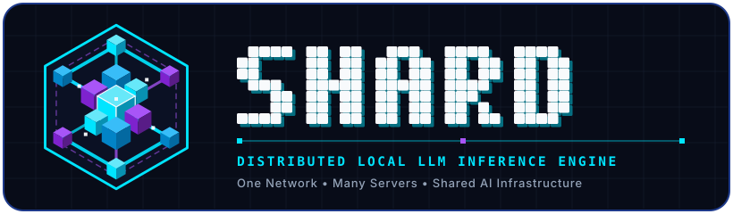
  </picture>
</p>

<h1 align="center">SHARD</h1>

<p align="center">
  <strong>Бір желі. Көптеген серверлер. Ортақ ЖИ инфрақұрылымы.</strong><br>
  <sub>Жергілікті желідегі (LAN) компьютерлердің бейнежады (VRAM) мен жедел жадын (RAM) біріктіретін, PyTorch, FastAPI, <code>llama.cpp</code> RPC және нативті C++20 / MASM AVX2 SIMD ядролары негізінде жасалған таратылған LLM инференс қозғалтқышы.</sub>
</p>

<p align="center">
  <a href="README.md"></a>
  <a href="README.ru.md"></a>
  <a href="README.kz.md"></a>
  <a href="docs/LAN_SHARDING_DESIGN.md"></a>
  <a href="#орнату-және-жылдам-бастау"></a>
  <a href="#орнату"></a>
  <a href="https://github.com/avelone123123/shard/discussions"></a>
  <a href="https://github.com/avelone123123/shard/issues"></a>
</p>

<p align="center">
  <a href="https://github.com/avelone123123/shard/releases"></a>
  <a href="https://www.python.org/"></a>
  <a href="LICENSE"></a>
  <a href="https://github.com/avelone123123/shard/actions/workflows/tests.yml"></a>
  
  
</p>

<p align="center">
  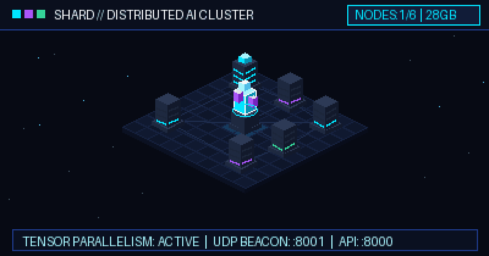
  <br>
  <sub><b>SHARD таратылған инференс кластері:</b> Орталық мастер-үйлестіруші UDP-анықтау (<code>:8001</code>) және FastAPI SSE-сервері (<code>:8000</code>) арқылы жергілікті желідегі жұмысшы түйіндердің бейнежадын біріктіреді.</sub>
</p>

<p align="center">
  <a href="#shard-дегеніміз-не">Жоба туралы</a> &middot;
  <a href="#shard-қалай-жұмыс-істейді">Жұмыс принципі</a> &middot;
  <a href="#мүмкіндіктері">Мүмкіндіктері</a> &middot;
  <a href="#орнату-және-жылдам-бастау">Жылдам бастау</a> &middot;
  <a href="#cli-анықтамалығы-және-баптаулар">CLI командалары</a> &middot;
  <a href="#архитектура">Архитектура</a> &middot;
  <a href="#веб-басқару-тақтасы-және-демонстрация">Веб-тақта</a> &middot;
  <a href="#жоба-мәртебесі-және-қауымдастық">Қауымдастық</a>
</p>

---

## SHARD дегеніміз не?

**[SHARD](https://github.com/avelone123123/shard)** (`shard-engine`) — Python ([FastAPI](https://fastapi.tiangolo.com/) + [PyTorch](https://pytorch.org/)) тілінде жазылған, [GGUF / `llama.cpp`](https://github.com/ggml-org/llama.cpp) бэкендімен және нативті C++20 / MASM AVX2 SIMD аппараттық жеделдетуімен жабдықталған ашық бастапқы кодты таратылған үлкен тілдік модельдер (LLM) қозғалтқышы.

### Ол қандай мәселені шешеді?
14B, 32B немесе 70B+ параметрлі заманауи ашық тілдік модельдерді жергілікті компьютерде іске қосу кезінде ең жиі кездесетін кедергі — **бір бейнекартаның VRAM көлемінің жетіспеушілігі**. Көптеген әзірлеушілер мен зертханаларда бір жергілікті желіге қосылған бірнеше құрылғы (жұмыс компьютері, ноутбук, қосымша сервер) болады, бірақ олардың жады бір-бірімен байланыспағандықтан, үлкен модельді жеке-дара көтере алмайды.

### SHARD не үшін жасалды?
SHARD жергілікті желідегі (LAN) бос тұрған GPU мен RAM ресурстарын бірыңғай есептеу кластеріне біріктіреді:
- **Бұлттық сервистерсіз жадты біріктіру:** Трансформер қабаттарын гигабиттік жергілікті желі (`lan.py`, `gguf_backend.py`) арқылы бірнеше бейнекарта мен жедел жадқа бөліп орналастырыңыз — сыртқы API төлемдерінсіз және деректерді сыртқа жібермей.
- **Жүктемес бұрын үйлесімділікті тексеру (`shard fit`):** Көп гигабайттық модель салмақтарын жүктемес бұрын, оның сіздің GPU-ға, гибридті CPU+GPU режиміне немесе біріктірілген LAN-кластерге сыятынын алдын ала есептеңіз (`fit.py`).
- **ЖИ-агенттер мен IDE-ге дайын сервер:** Порт `8000` арқылы OpenAI (`/v1/chat/completions`, `/v1/completions`, `/v1/models`) және Anthropic (`/v1/messages`) стандартты эндпоинттерін ұсынады.

### SHARD кімдерге арналған?
- **Жергілікті ЖИ әзірлеушілері мен зерттеушілеріне** — 7B–70B GGUF немесе SafeTensors модельдерін өз жабдықтарында іске қосу үшін.
- **Инженерлік топтарға** — [Cursor](https://www.cursor.com/), [Claude Code](https://docs.anthropic.com/en/docs/agents-and-tools/claude-code/overview), [Aider](https://aider.chat/), [Continue](https://www.continue.dev/), [Zed](https://zed.dev/) және [OpenCode](https://github.com/opencode-ai/opencode) үшін құпия локалды кодтау көмекшілерін ұйымдастыру үшін.
- **ЖИ-агент құрастырушыларына** — [OpenAI Python SDK](https://github.com/openai/openai-python), [LangChain](https://www.langchain.com/) немесе [LlamaIndex](https://www.llamaindex.ai/) негізіндегі агенттерді өз серверлерінде қосу үшін.

---

## SHARD қалай жұмыс істейді?

SHARD жұмыс процесі төрт негізгі қадамнан тұрады: **ҚҰРУ (CREATE) → БӨЛІСУ (SHARE) → ҚОСЫЛУ (CONNECT) → ҚОЛДАНУ (USE)**.

<table>
  <tr>
    <td width="50%" valign="top">
      <h3 align="center">1. CREATE — Өз серверіңізді іске қосыңыз</h3>
      <p align="center">
        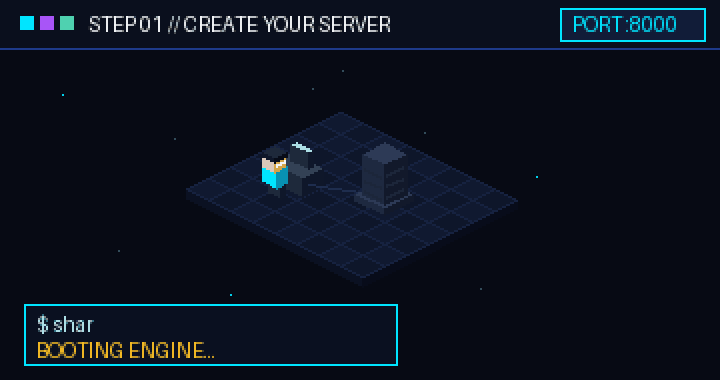
      </p>
      <p>
        Жергілікті түйінді <code>shard start</code> немесе <code>python main.py</code> командасымен қосыңыз. <code>hardware.py</code> модулі CPU, RAM және GPU (NVIDIA CUDA / Apple MPS) көрсеткіштерін анықтап, таңдалған GGUF немесе Hugging Face моделін жүктейді және <code>http://localhost:8000</code> адресінде FastAPI сервері мен веб-интерфейсті ашады.
      </p>
    </td>
    <td width="50%" valign="top">
      <h3 align="center">2. SHARE — Желімен бөлісіңіз</h3>
      <p align="center">
        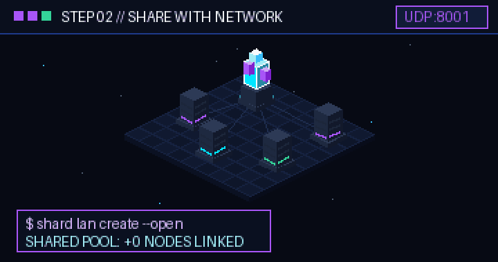
      </p>
      <p>
        <code>shard lan create --open</code> командасымен ашық LAN есептеу пулын құрыңыз (немесе <code>shard lan create</code> арқылы жұптастыру кодын алыңыз). SHARD <code>8001</code> портында UDP-маяктарды таратып, желідегі басқа компьютерлердің VRAM мен RAM жадын біріктіру үшін <code>/api/lan/*</code> маршруттарын іске қосады.
      </p>
    </td>
  </tr>
  <tr>
    <td width="50%" valign="top">
      <h3 align="center">3. CONNECT — Жұмысшы түйіндерді қосыңыз</h3>
      <p align="center">
        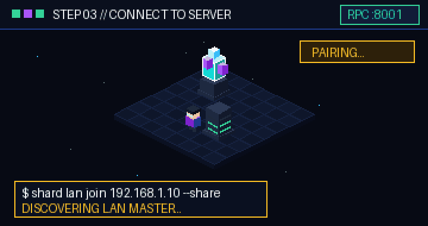
      </p>
      <p>
        Желідегі кез келген қосымша компьютерде <code>shard lan join &lt;мастер-IP&gt; --share</code> командасын орындаңыз. Жұмысшы түйін авторизациядан өтіп (<code>POST /api/lan/pair</code>), жергілікті RPC-воркерді іске қосады, телеметрия жіберіп тұрады және өз GPU/RAM ресурстарын ортақ кластерге қосады.
      </p>
    </td>
    <td width="50%" valign="top">
      <h3 align="center">4. USE — ЖИ-агенттерді іске қосыңыз</h3>
      <p align="center">
        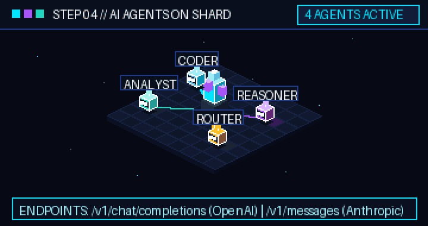
      </p>
      <p>
        Код редакторларын, автономды ЖИ-агенттерді немесе Python қосымшаларын <code>http://&lt;мастер-IP&gt;:8000/v1/chat/completions</code> не <code>/v1/messages</code> адресіне бағыттаңыз. Мастер-түйін модель қабаттарының орындалуын үйлестіріп, токендерді Server-Sent Events (SSE) арқылы нақты уақытта қайтарады.
      </p>
    </td>
  </tr>
</table>

---

## Мүмкіндіктері

Төмендегі барлық мүмкіндіктер [SHARD](https://github.com/avelone123123/shard) (`v1.8.0`) репозиторийінің нақты бастапқы коды бойынша тексерілген.

### Іске асырылған мүмкіндіктер

| Санат | Мүмкіндік | Бастапқы код модулі | Сипаттамасы |
| :--- | :--- | :--- | :--- |
| **LAN-кластер және шардинг** | **UDP авто-анықтау және жад пулингі** | [`lan.py`](lan.py), [`docs/LAN_SHARDING_DESIGN.md`](docs/LAN_SHARDING_DESIGN.md) | UDP-маяктарды (`:8001`) таратады, код немесе `--open` режимі арқылы түйіндерді жұптастырады, `/api/lan/heartbeat` арқылы күйді бақылайды және VRAM/RAM біріктіреді. |
| **Инференс бэкендтері** | **Қос PyTorch және GGUF (`llama.cpp`) қозғалтқышы** | [`engine.py`](engine.py), [`gguf_backend.py`](gguf_backend.py) | Hugging Face (`transformers` / `safetensors`) модельдерін CUDA/CPU/MPS-те және квантталған GGUF модельдерін `llama-server` мен `ggml-rpc-server` арқылы GPU қабаттарын (`-ngl`) баптай отырып орындайды. |
| **Жабдықты бағалау** | **Алдын ала үйлесімділік кеңесшісі (`shard fit`)** | [`fit.py`](fit.py), [`hardware.py`](hardware.py) | Модельді жүктемес бұрын оның архитектурасын талдап, `GPU`, `HYBRID` немесе `IMPOSSIBLE` вердиктін, максималды контекст терезесін, болжамды жылдамдықты (tok/s) және оңтайлы кванттауды көрсетеді. |
| **Нативті жеделдету** | **C++20 және MASM AVX2 SIMD ядролары** | [`native/shard_core.cpp`](native/shard_core.cpp), [`native/shard_asm.asm`](native/shard_asm.asm), [`shard_bridge.py`](shard_bridge.py) | `ctypes` арқылы қосылатын `RMSNorm`, `LayerNorm`, айналмалы эмбеддингтер (`RoPE`), `Softmax`, `GELU`, `SiLU` және `MatMul` үшін C++20 және x86-64 AVX2 ассемблерлік функциялары. |
| **API және стриминг** | **OpenAI және Anthropic API үйлесімділігі** | [`server.py`](server.py) | Нақты уақыттағы SSE стримингі және API-кілт қорғанысы (`shard key`) бар `/v1/chat/completions`, `/v1/completions`, `/v1/models`, `/v1/messages` (Anthropic) және `/api/generate` маршруттары. |
| **Веб-басқару** | **Тәуелсіз басқару тақтасы (`dashboard.html`)** | [`dashboard.html`](dashboard.html) | `http://localhost:8000` адресіндегі GPU/VRAM/RAM телеметриясы, Hugging Face модельдерін іздеу/жүктеу, интерактивті чат, LAN-пул менеджері және IDE интеграция блоктары бар веб-интерфейс. |
| **Контейнерлеу** | **Docker және NVIDIA GPU Compose стегі** | [`Dockerfile`](Dockerfile), [`docker-compose.yml`](docker-compose.yml) | Тұрақты томдары (`shard_models_volume`, `shard_data_volume`) және NVIDIA GPU қолдауы бар дайын контейнерлік конфигурация. |

### Эксперименттік мүмкіндіктер
- **Көп-хосттық `llama.cpp` RPC тензорлық тарату (`gguf_backend.py`, `lan.py`):** LAN ішіндегі әртүрлі бейнекарталар арасында TCP/RPC арқылы қабаттарды бөліп есептеу сымды Gigabit / 2.5GbE Ethernet желілерінде ең жоғары өнімділік көрсетеді; Wi-Fi желісінде кідіріс жоғары болуы мүмкін.
- **Нативті Win32 десктоп интерфейсі (`native/shard_gui.cpp`):** Веб-тақтамен қатар Windows жүйесіне арналған C++ графикалық қосымшасы.

### Жоспарланған мүмкіндіктер
- **Түйін үзілгенде қабаттарды автоматты қайта бөлу:** Генерация барысында жұмысшы түйін желіден ажырап қалса, жүктемені үзіліссіз қайта бөлу (`docs/LAN_SHARDING_DESIGN.md`).
- **Linux / macOS ARM64 NEON нұсқаулықтары:** Нативті SIMD ядроларын (`native/`) Apple Silicon және ARM64 процессорларына бейімдеу.

---

## Орнату және жылдам бастау

### Алғышарттар
- **ОЖ:** Windows 10/11 (64-bit), Linux (Ubuntu 20.04+ / Debian 12+) немесе macOS.
- **Python:** `3.8+` нұсқасы (`3.10+` ұсынылады).
- **Аппараттық құралдар:** CUDA драйверлері бар NVIDIA GPU (ұсынылады), Apple Silicon (MPS) немесе AVX2 қолдайтын x86-64 процессоры.
- **Желі (LAN-кластер үшін):** Бір ішкі желіде орналасқан, TCP `8000` (API/UI) және UDP/TCP `8001` (LAN анықтау және RPC) порттары ашық екі немесе одан көп компьютер.

### Орнату

#### 1-нұсқа: Бастапқы кодтан орнату (ұсынылады)
```bash
git clone https://github.com/avelone123123/shard.git
cd shard
pip install -e .
```
`pip install -e .` командасы жүйеге `shard` CLI утилитасын (`shard = "cli:main"`) тіркейді.

#### 2-нұсқа: Docker Compose арқылы іске қосу (NVIDIA GPU қолдауымен)
```bash
git clone https://github.com/avelone123123/shard.git
cd shard
docker-compose up --build
```

#### 3-нұсқа: Нативті C++20 / MASM AVX2 ядроларын компиляциялау (қосымша)
`shard_core.dll` (Windows MSVC `cl.exe` + `ml64.exe`) немесе `shard_core.so` (Linux GCC/Clang) жинау үшін:
```bash
python native/build_native.py
```

---

### Жылдам бастау қадамдары

#### 1. SHARD серверін және веб-тақтасын іске қосу
```bash
# FastAPI серверін қосу және http://localhost:8000 веб-тақтасын браузерде ашу
shard gui

# Немесе белгілі бір хост пен портта іске қосу
shard start --host 0.0.0.0 --port 8000

# Немесе тікелей Python арқылы қосу
python main.py
```

#### 2. Жабдық күйін және модель сыйымдылығын тексеру
```bash
# CPU, RAM және GPU VRAM күйін көру
shard status

# Модельді жүктемес бұрын оның жүйеге сәйкестігін тексеру
shard fit Qwen/Qwen2.5-Coder-7B-Instruct
shard fit meta-llama/Llama-3.1-8B-Instruct
```

#### 3. Модельді жүктеу және іске қосу
```bash
# Модельді жүктеп, іске қосу (әдепкі: Qwen/Qwen2.5-Coder-1.5B-Instruct)
shard run Qwen/Qwen2.5-Coder-7B-Instruct

# Жергілікті және қолжетімді модельдер тізімін көру
shard list
```

#### 4. Таратылған LAN-кластерді құру немесе оған қосылу
**Басты компьютерде (Master)** (мысалы, `192.168.1.10`):
```bash
# Жергілікті желіде ашық пул құру және GPU ресурстарын бөлісу
shard lan create --open --share

# Немесе кодпен қорғалған LAN пулын құру
shard lan create --share
```

Бір желідегі әрбір **жұмысшы компьютерде (Worker)**:
```bash
# Мастер-түйін кластеріне қосылу және жергілікті GPU/RAM ресурсын бөлісу
shard lan join 192.168.1.10 --share

# Кластер түйіндерін және біріктірілген жад көлемін тексеру
shard lan status

# LAN пулынан шығу
shard lan off
```

---

## CLI анықтамалығы және баптаулар

### Тексерілген CLI командалары (`cli.py`)

| Команда | Аргументтер мен жалаушалар | Сипаттамасы |
| :--- | :--- | :--- |
| `shard start` | `[--host HOST] [--port PORT]` | SHARD FastAPI серверін және Uvicorn ортасын іске қосады (әдепкі `0.0.0.0:8000`). |
| `shard gui` | *(жоқ)* | Серверді қосып, браузерде интерактивті веб-тақтаны (`dashboard.html`) ашады. |
| `shard status` | *(жоқ)* | CPU ядроларын, жүйелік RAM, GPU моделі, VRAM жүктемесі мен қозғалтқыш күйін көрсетеді. |
| `shard fit` | `[model_id]` | Модельге қажетті VRAM/RAM көлемін, кванттау түрін және жылдамдықты есептейді (`fit.py`). |
| `shard run` | `[model_id]` | Көрсетілген модельді жүктеп (қажет болса), іске қосады. |
| `shard list` | `[--category CAT]` | Жергілікті кэштелген және каталогтағы модельдерді тізімдейді (`all`, `coding`, `chat`). |
| `shard lan` | `[status\|create\|join\|off] [extra] [--share] [--open]` | Жергілікті желідегі есептеу пулын құру, қосылу, тексеру немесе тоқтату. |
| `shard key` | `[--gen]` | Жергілікті API кілтін көрсетеді немесе жаңа токен жасайды (`--gen`). |
| `shard models-dir` | `[path \| reset]` | Модель салмақтары сақталатын бума жолын көрсетеді, өзгертеді немесе бастапқы қалпына келтіреді. |
| `shard test` | *(жоқ)* | Ішкі модульдік тесттер мен аппараттық бенчмарктарды орындайды (`tests_shard.py`). |
| `shard help` | *(жоқ)* | Барлық CLI командалары бойынша толық анықтаманы шығарады. |

### Қоршаған орта айнымалылары және баптау файлдары (`settings.py`, `main.py`, `docker-compose.yml`)

| Айнымалы / Файл | Әдепкі мәні | Қызметі |
| :--- | :--- | :--- |
| `SHARD_HOST` | `0.0.0.0` | Сервер байланысатын желілік интерфейс IP-адресі. |
| `SHARD_PORT` | `8000` | API сервері мен веб-тақтаға арналған HTTP порты. |
| `SHARD_MODELS_DIR` | `~/.shard/models` (Docker-де `/data/models`) | Жүктелген Hugging Face SafeTensors және GGUF модельдерін сақтау бумасы. |
| `SHARD_DATA_DIR` | `~/.shard` (Docker-де `/data/shard`) | `settings.json` және `lan.json` файлдары сақталатын бума. |
| `SHARD_DOCKER` | *(орнатылмаған)* | Орнатылған кезде контейнер ішінде браузерді автоматты ашуды өшіреді. |
| `HF_HOME` / `TRANSFORMERS_CACHE` | `~/.cache/huggingface` | Hugging Face модельдерінің кэш бумасы. |
| `~/.shard/settings.json` | Автоматты жасалады | Тұрақты JSON баптаулар файлы (`models_dir`, API кілттері және т.б.). |
| `engine_optimizations.json` | Репозиторий түбірі | Орындалу уақытының оңтайландыру профилі (CPU ағындары, SIMD жалаушалары, батч өлшемдері). |

---

## Архитектура

<p align="center">
  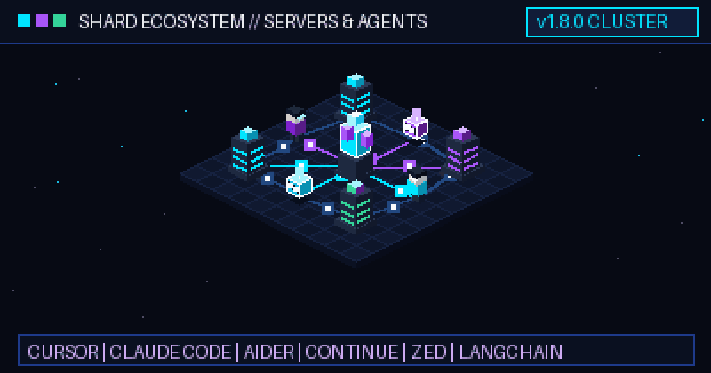
  <br>
  <sub><b>SHARD экожүйесінің топологиясы:</b> Кодтау орталары, агенттік фреймворктер, орталық үйлестіруші және LAN жұмысшы түйіндері біртұтас есептеу жүйесі ретінде жұмыс істейді.</sub>
</p>

### Жүйе архитектурасының диаграммасы

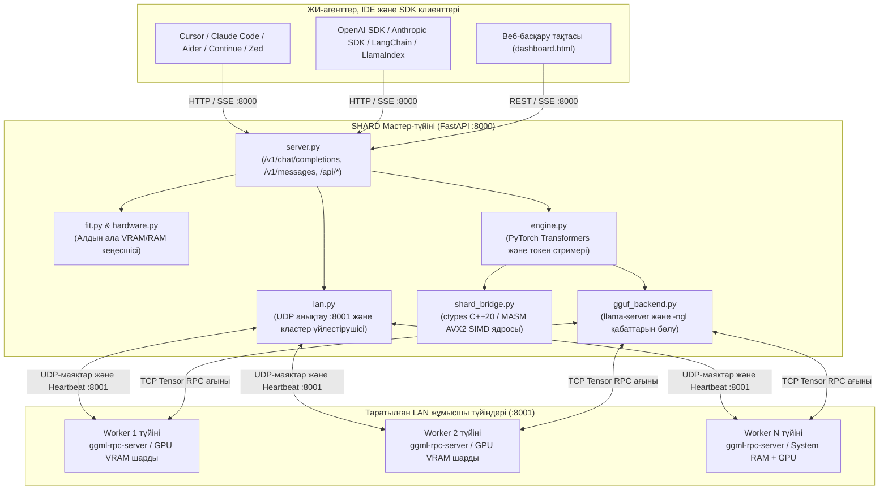

---

## Веб-басқару тақтасы және демонстрация

### Интерактивті басқару тақтасы (`dashboard.html`)
Браузерде `http://localhost:8000` адресін ашып, SHARD басқару тақтасына өтіңіз:

<p align="center">
  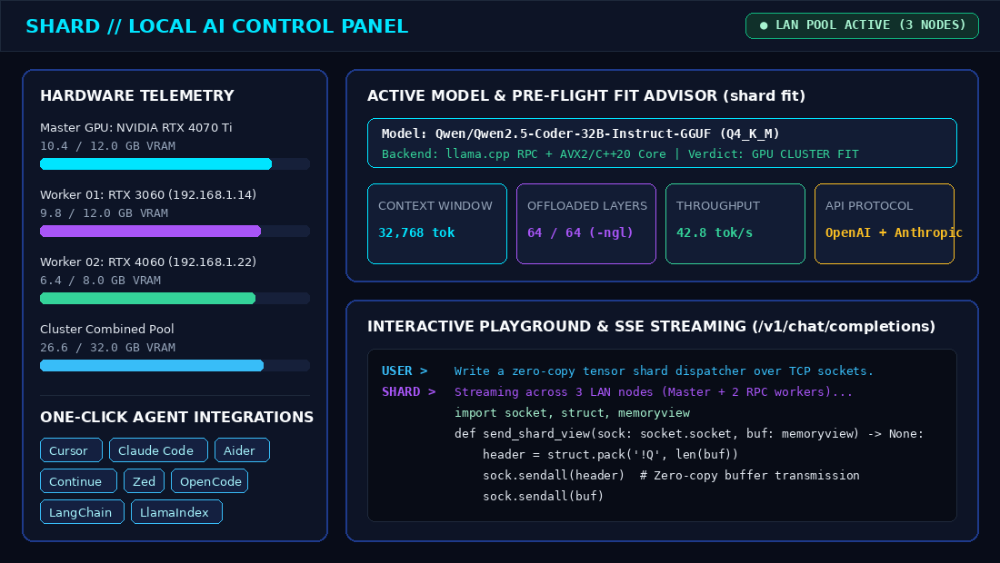
  <br>
  <sub><b>SHARD веб-тақтасы:</b> Нақты уақыттағы VRAM/RAM көрсеткіштері, модель сыйымдылығының кеңесшісі, IDE-ні бір батырмамен баптау және стриминг чаты.</sub>
</p>

### CLI үйлесімділік кеңесшісі (`shard fit`) және LAN кластер мәртебесі (`shard lan status`)

<p align="center">
  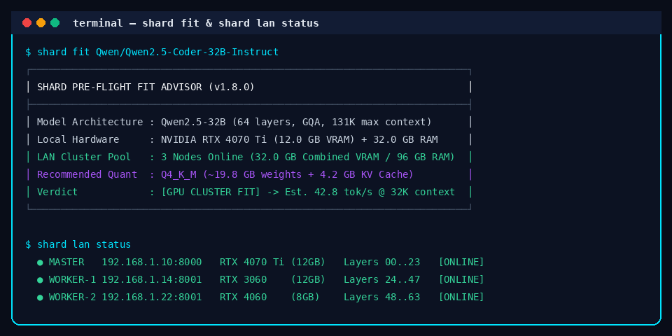
  <br>
  <sub><b>Алдын ала тексеру:</b> Модель салмақтарын жүктемес бұрын кванттау деңгейін, контекст көлемін және LAN кластеріне сыйымдылығын бағалау.</sub>
</p>

### OpenAI Python SDK арқылы қосылу мысалы

```python
from openai import OpenAI

client = OpenAI(
    base_url="http://localhost:8000/v1",
    api_key="shard-local",  # Немесе `shard key --gen` арқылы жаңа кілт жасаңыз
)

stream = client.chat.completions.create(
    model="Qwen/Qwen2.5-Coder-7B-Instruct",
    messages=[{"role": "user", "content": "Жергілікті желідегі тензорлық параллелизм қалай жұмыс істейді?"}],
    stream=True,
)

for chunk in stream:
    if chunk.choices[0].delta.content:
        print(chunk.choices[0].delta.content, end="", flush=True)
```

---

## Жоба мәртебесі және қауымдастық

### Технологиялық стек
- **Орындау ортасы және API:** Python 3.8+ / 3.10+, [FastAPI](https://fastapi.tiangolo.com/), [Uvicorn](https://www.uvicorn.org/), [Pydantic v2](https://docs.pydantic.dev/)
- **ML және кванттау:** [PyTorch](https://pytorch.org/), Hugging Face [`transformers`](https://huggingface.co/docs/transformers), [`accelerate`](https://huggingface.co/docs/accelerate), [`safetensors`](https://huggingface.co/docs/safetensors), [`huggingface_hub`](https://huggingface.co/docs/huggingface_hub), [`llama.cpp` GGUF](https://github.com/ggml-org/llama.cpp)
- **Нативті жеделдету:** C++20 (`native/shard_core.cpp`) + x86-64 MASM AVX2 ассемблері (`native/shard_asm.asm`)
- **Желі және телеметрия:** `psutil`, UDP broadcast анықтау (`:8001`), HTTP/SSE стриминг (`:8000`)

### Құжаттама және жобаға үлес қосу
- **LAN шардинг архитектурасы:** [`docs/LAN_SHARDING_DESIGN.md`](docs/LAN_SHARDING_DESIGN.md)
- **Үлес қосушыларға нұсқаулық:** [`CONTRIBUTING.md`](CONTRIBUTING.md)
- **Мінез-құлық кодексі:** [`CODE_OF_CONDUCT.md`](CODE_OF_CONDUCT.md)
- **Өзгерістер тарихы:** [`CHANGELOG.md`](CHANGELOG.md) (ағымдағы нұсқа: `v1.8.0`)
- **Қателер мен ұсыныстар:** [GitHub Issues](https://github.com/avelone123123/shard/issues)
- **Талқылаулар мен сұрақтар:** [GitHub Discussions](https://github.com/avelone123123/shard/discussions)
- **Қауіпсіздік саясаты:** Қауіпсіздік осалдықтары туралы [GitHub Security Advisories](https://github.com/avelone123123/shard/security) арқылы хабарлаңыз.
- **Лицензия:** [MIT License](LICENSE) лицензиясы бойынша таратылады.

---

<p align="center">
  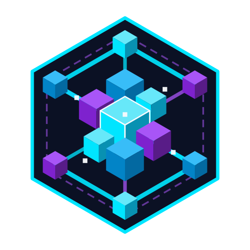<br>
  <strong>SHARD — Бір желі. Көптеген серверлер. Ортақ ЖИ инфрақұрылымы.</strong><br>
  <sub>Ашық жергілікті ЖИ қауымдастығы үшін жасалған &middot; <a href="README.md">English</a> &middot; <a href="README.ru.md">Русский</a> &middot; <a href="README.kz.md">Қазақша</a></sub>
</p>
