<p align="center">
  <strong>English</strong> &nbsp;|&nbsp;
  <a href="README.ru.md">Русская версия</a> &nbsp;|&nbsp;
  <a href="README.kz.md">Қазақша нұсқасы</a>
</p>

<p align="center">
  <picture>
    <source media="(prefers-color-scheme: dark)" srcset="assets/branding/shard-logo-dark.svg">
    <source media="(prefers-color-scheme: light)" srcset="assets/branding/shard-logo-light.svg">
    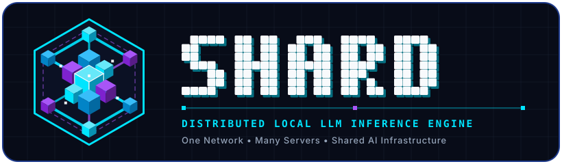
  </picture>
</p>

<h1 align="center">SHARD</h1>

<p align="center">
  <strong>One Network. Many Servers. Shared AI Infrastructure.</strong><br>
  <sub>Distributed local LLM inference engine pooling GPU VRAM and system RAM across LAN machines — powered by PyTorch, FastAPI, <code>llama.cpp</code> RPC, and native C++20 / MASM AVX2 SIMD kernels.</sub>
</p>

<p align="center">
  <a href="README.md"></a>
  <a href="README.ru.md"></a>
  <a href="README.kz.md"></a>
  <a href="docs/LAN_SHARDING_DESIGN.md"></a>
  <a href="#installation--quick-start"></a>
  <a href="#installation"></a>
  <a href="https://github.com/avelone123123/shard/discussions"></a>
  <a href="https://github.com/avelone123123/shard/issues"></a>
</p>

<p align="center">
  <a href="https://github.com/avelone123123/shard/releases"></a>
  <a href="https://www.python.org/"></a>
  <a href="LICENSE"></a>
  <a href="https://github.com/avelone123123/shard/actions/workflows/tests.yml"></a>
  
  
</p>

<p align="center">
  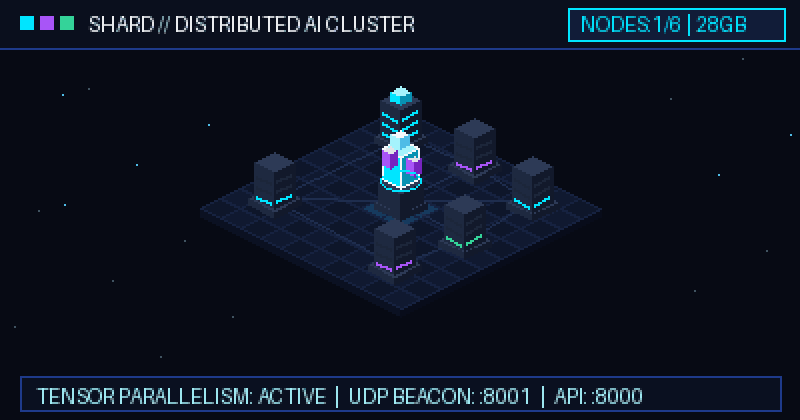
  <br>
  <sub><b>SHARD Distributed Inference Cluster:</b> Central master coordinator pooling VRAM across connected LAN worker nodes over UDP discovery (<code>:8001</code>) and FastAPI SSE endpoints (<code>:8000</code>).</sub>
</p>

<p align="center">
  <a href="#what-is-shard">Overview</a> &middot;
  <a href="#how-shard-works">How It Works</a> &middot;
  <a href="#features">Features</a> &middot;
  <a href="#installation--quick-start">Quick Start</a> &middot;
  <a href="#cli-reference--configuration">CLI Reference</a> &middot;
  <a href="#architecture">Architecture</a> &middot;
  <a href="#web-dashboard--demonstrations">Dashboard</a> &middot;
  <a href="#project-status--community">Community</a>
</p>

---

## What Is SHARD?

**[SHARD](https://github.com/avelone123123/shard)** (`shard-engine`) is an open-source distributed local LLM inference engine written in Python ([FastAPI](https://fastapi.tiangolo.com/) + [PyTorch](https://pytorch.org/)) with a [GGUF / `llama.cpp` backend](https://github.com/ggml-org/llama.cpp) and native C++20 / MASM AVX2 SIMD acceleration.

### The Problem It Solves
Running capable 14B, 32B, or 70B+ open-weight language models locally typically hits a hard hardware wall: **single-card VRAM limits**. Most developers, labs, and small teams own multiple machines—a desktop gaming GPU, a workstation laptop, an auxiliary mini-PC—whose memory sits fragmented across the local network while no single device can fit the full model weights and KV cache.

### Why SHARD Exists
SHARD unites idle GPUs and system memory across your Local Area Network (LAN) into a single logical inference cluster:
- **Pool Hardware Without Cloud Lock-In:** Split transformer layers across multiple consumer GPUs and host RAM over standard gigabit LAN (`lan.py`, `gguf_backend.py`) with zero external cloud dependencies or recurring API fees.
- **Know Before You Download (`shard fit`):** Inspect whether any Hugging Face model will fit your single GPU, hybrid CPU+GPU setup, or pooled LAN cluster before downloading gigabytes of weights (`fit.py`).
- **Drop-In Agent & IDE Backend:** Expose both OpenAI (`/v1/chat/completions`, `/v1/completions`, `/v1/models`) and Anthropic (`/v1/messages`) compatible endpoints on port `8000` so coding agents and SDKs connect immediately.

### Who Should Use SHARD?
- **Local AI Developers & Researchers** running 7B–70B GGUF or PyTorch SafeTensors models across home lab or office workstations.
- **Software Engineering Teams** hosting private, zero-telemetry coding assistants for [Cursor](https://www.cursor.com/), [Claude Code](https://docs.anthropic.com/en/docs/agents-and-tools/claude-code/overview), [Aider](https://aider.chat/), [Continue](https://www.continue.dev/), [Zed](https://zed.dev/), and [OpenCode](https://github.com/opencode-ai/opencode).
- **AI Agent Builders** orchestrating multi-agent pipelines via [OpenAI Python SDK](https://github.com/openai/openai-python), [LangChain](https://www.langchain.com/), or [LlamaIndex](https://www.llamaindex.ai/) against self-hosted hardware.

---

## How SHARD Works

SHARD turns distributed local AI infrastructure into a four-step workflow: **CREATE → SHARE → CONNECT → USE**.

<table>
  <tr>
    <td width="50%" valign="top">
      <h3 align="center">1. CREATE — Launch Your Server</h3>
      <p align="center">
        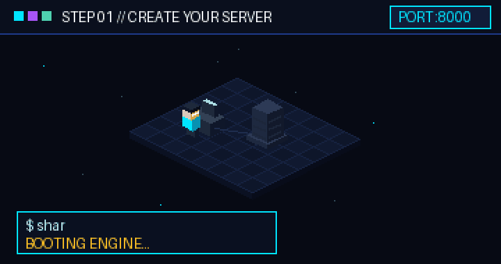
      </p>
      <p>
        Start a local SHARD node with <code>shard start</code> or <code>python main.py</code>. The engine probes your CPU, system RAM, and NVIDIA CUDA / Apple MPS GPU via <code>hardware.py</code>, loads your chosen GGUF or Hugging Face model, and brings up the FastAPI server and Web UI on <code>http://localhost:8000</code>.
      </p>
    </td>
    <td width="50%" valign="top">
      <h3 align="center">2. SHARE — Broadcast to the LAN</h3>
      <p align="center">
        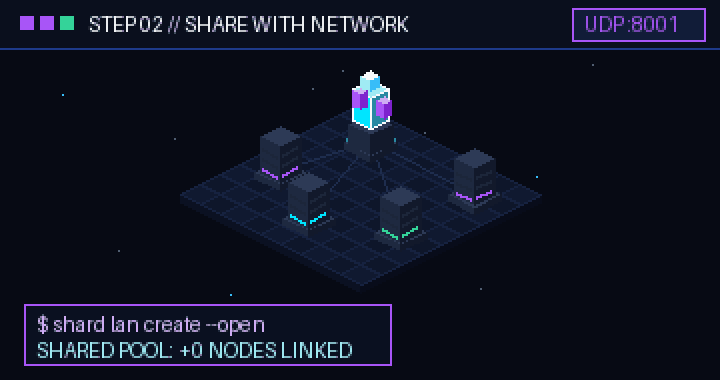
      </p>
      <p>
        Open a LAN compute pool with <code>shard lan create --open</code> (or generate a pairing code via <code>shard lan create</code>). SHARD broadcasts UDP discovery beacons on port <code>8001</code> and exposes <code>/api/lan/*</code> endpoints so peer machines on your subnet can pool their VRAM and RAM.
      </p>
    </td>
  </tr>
  <tr>
    <td width="50%" valign="top">
      <h3 align="center">3. CONNECT — Pair Worker Nodes</h3>
      <p align="center">
        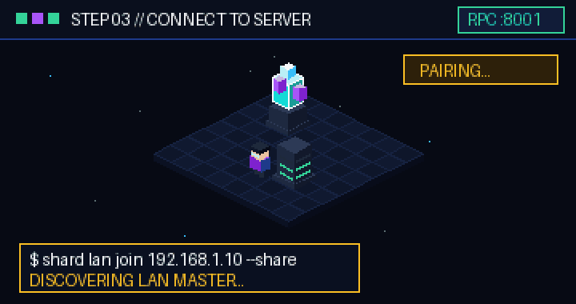
      </p>
      <p>
        On any secondary computer on the network, run <code>shard lan join &lt;master-ip&gt; --share</code>. The worker completes an HTTP handshake (<code>POST /api/lan/pair</code>), launches its local RPC tensor worker, sends periodic health heartbeats, and contributes its GPU/RAM to the cluster.
      </p>
    </td>
    <td width="50%" valign="top">
      <h3 align="center">4. USE — Power AI Agents & Apps</h3>
      <p align="center">
        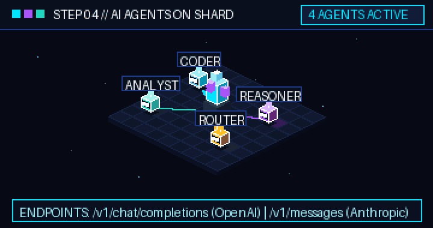
      </p>
      <p>
        Connect coding IDEs, autonomous AI agents, or custom Python apps to <code>http://&lt;master-ip&gt;:8000/v1/chat/completions</code> or <code>/v1/messages</code>. Master coordinates layer execution across connected nodes and streams tokens back via Server-Sent Events (SSE).
      </p>
    </td>
  </tr>
</table>

---

## Features

Every feature listed below is verified directly against the [SHARD source tree](https://github.com/avelone123123/shard) (`v1.8.0`).

### Implemented Features

| Category | Capability | Source Module | Description |
| :--- | :--- | :--- | :--- |
| **LAN Cluster & Sharding** | **UDP Auto-Discovery & LAN Pooling** | [`lan.py`](lan.py), [`docs/LAN_SHARDING_DESIGN.md`](docs/LAN_SHARDING_DESIGN.md) | Broadcasts UDP beacons (`:8001`), pairs nodes via code or `--open` mode, monitors node heartbeats (`/api/lan/heartbeat`), and pools VRAM/RAM across machines. |
| **Inference Backends** | **Dual PyTorch & GGUF (`llama.cpp`) Engine** | [`engine.py`](engine.py), [`gguf_backend.py`](gguf_backend.py) | Runs Hugging Face `transformers` / `safetensors` models on CUDA/CPU/MPS and quantized GGUF weights via managed `llama-server` & `ggml-rpc-server` subprocesses with configurable GPU layer offload (`-ngl`). |
| **Hardware Planning** | **Pre-Flight Model Fit Advisor (`shard fit`)** | [`fit.py`](fit.py), [`hardware.py`](hardware.py) | Inspects model architecture parameters (`config.json` or parameter heuristics) against host VRAM and RAM before downloading, returning `GPU`, `HYBRID`, or `IMPOSSIBLE` verdicts, max context length, estimated tok/s, and quantization advice. |
| **Native Acceleration** | **C++20 & MASM AVX2 SIMD Kernels** | [`native/shard_core.cpp`](native/shard_core.cpp), [`native/shard_asm.asm`](native/shard_asm.asm), [`shard_bridge.py`](shard_bridge.py) | Custom C++20 and x86-64 AVX2 assembly routines for `RMSNorm`, `LayerNorm`, Rotary Position Embeddings (`RoPE`), `Softmax`, `GELU`, `SiLU`, and `MatMul` loaded via `ctypes`. |
| **API & Streaming** | **OpenAI & Anthropic Compatible Server** | [`server.py`](server.py) | Serves `/v1/chat/completions`, `/v1/completions`, `/v1/models`, `/v1/messages` (Anthropic protocol), `/api/generate`, and `/api/generate/stream` with real-time Server-Sent Events (SSE) and optional API key auth (`shard key`). |
| **Web Control Panel** | **Zero-Dependency Dashboard & Playground** | [`dashboard.html`](dashboard.html) | Built-in browser UI at `http://localhost:8000` with live GPU/VRAM/RAM telemetry, Hugging Face model search & download, quantization selector, streaming chat playground, LAN node manager, and one-click IDE integration snippets. |
| **Containerization** | **Docker & NVIDIA GPU Compose Stack** | [`Dockerfile`](Dockerfile), [`docker-compose.yml`](docker-compose.yml) | Production-ready container setup with persistent named volumes (`shard_models_volume`, `shard_data_volume`) and NVIDIA GPU reservation. |

### Experimental Features
- **Multi-Host `llama.cpp` RPC Tensor Distribution (`gguf_backend.py`, `lan.py`):** Distributed layer execution over TCP/RPC across heterogeneous LAN GPUs works best on low-latency wired Gigabit/2.5GbE Ethernet subnets; Wi-Fi links may experience higher inter-token latency.
- **Native Win32 Desktop GUI (`native/shard_gui.cpp`):** Native C++ Windows desktop wrapper alongside the cross-platform web dashboard (`dashboard.html`).

### Planned Features
- **Automated Dynamic Re-Sharding on Node Dropout:** Seamless mid-generation layer migration if a worker node disconnects unexpectedly (`docs/LAN_SHARDING_DESIGN.md`).
- **Linux / macOS ARM64 NEON Intrinsics:** Expanding the native SIMD kernel suite (`native/`) beyond x86-64 AVX2/FMA to native Apple Silicon / ARM64 assembly paths.

---

## Installation & Quick Start

### Prerequisites
- **OS:** Windows 10/11 (64-bit), Linux (Ubuntu 20.04+ / Debian 12+), or macOS.
- **Python:** Python `3.8+` (`3.10+` recommended).
- **Hardware:** NVIDIA GPU with CUDA drivers (recommended for GPU acceleration), Apple Silicon (MPS), or x86-64 CPU with AVX2 support.
- **Network (Optional for LAN Sharding):** Two or more machines on the same LAN with TCP port `8000` (HTTP/API) and UDP/TCP port `8001` (LAN discovery & RPC) open.

### Installation

#### Option 1: Editable Install from Source (Recommended)
```bash
git clone https://github.com/avelone123123/shard.git
cd shard
pip install -e .
```
Installing with `pip install -e .` registers the `shard` CLI command (`shard = "cli:main"`) in your environment.

#### Option 2: Docker Compose (with NVIDIA GPU Support)
```bash
git clone https://github.com/avelone123123/shard.git
cd shard
docker-compose up --build
```
This builds `shard-engine`, mounts persistent volumes (`/data/models` and `/data/shard`), exposes port `8000:8000`, and enables NVIDIA GPU passthrough.

#### Option 3: Compile Native C++20 / MASM AVX2 Kernels (Optional Speedup)
To compile `shard_core.dll` (Windows MSVC `cl.exe` + `ml64.exe`) or `shard_core.so` (Linux GCC/Clang):
```bash
python native/build_native.py
```

---

### Quick Start Workflow

#### 1. Launch the SHARD Server & Web Dashboard
```bash
# Start FastAPI server + open Web Dashboard at http://localhost:8000
shard gui

# Or start headless on a custom host/port
shard start --host 0.0.0.0 --port 8000

# Or run directly via Python entrypoint
python main.py
```

#### 2. Check Hardware & Model Fit Before Downloading
```bash
# Inspect your CPU, RAM, and GPU VRAM telemetry
shard status

# Check if a model fits your local machine or LAN cluster before downloading
shard fit Qwen/Qwen2.5-Coder-7B-Instruct
shard fit meta-llama/Llama-3.1-8B-Instruct
```

#### 3. Download & Run a Model
```bash
# Download and run the default model (Qwen/Qwen2.5-Coder-1.5B-Instruct) or specify any HF / GGUF model
shard run Qwen/Qwen2.5-Coder-7B-Instruct

# List cached and available models
shard list
```

#### 4. Create or Join a Distributed LAN Cluster
On the **Master Machine** (e.g., `192.168.1.10`):
```bash
# Create an open LAN pool (auto-accepts local subnet workers and shares GPU)
shard lan create --open --share

# Or create a code-protected LAN pool
shard lan create --share
```

On each **Worker Machine** on the same LAN:
```bash
# Join the master node's cluster and contribute local GPU/RAM
shard lan join 192.168.1.10 --share

# Check cluster nodes and pooled memory
shard lan status

# Leave or disable LAN pooling
shard lan off
```

---

## CLI Reference & Configuration

### Verified CLI Commands (`cli.py`)

| Command | Arguments & Flags | Description |
| :--- | :--- | :--- |
| `shard start` | `[--host HOST] [--port PORT]` | Launches the SHARD FastAPI server and Uvicorn runtime (default `0.0.0.0:8000`). |
| `shard gui` | *(none)* | Starts the server and opens the interactive Web Dashboard (`dashboard.html`) in your browser. |
| `shard status` | *(none)* | Displays detected CPU cores, system RAM, GPU model, VRAM usage, and active engine status. |
| `shard fit` | `[model_id]` | Runs the Pre-Flight Model Fit Advisor (`fit.py`) to calculate VRAM/RAM requirements, quantization fit, and estimated speed. |
| `shard run` | `[model_id]` | Downloads (if needed) and loads the specified model (defaults to `Qwen/Qwen2.5-Coder-1.5B-Instruct`). |
| `shard list` | `[--category CAT]` | Lists local cached models and curated catalog models (`all`, `coding`, `chat`, etc.). |
| `shard lan` | `[status\|create\|join\|off] [extra] [--share] [--open]` | Creates, joins, inspects, or stops distributed LAN compute pooling across machines. |
| `shard key` | `[--gen]` | Views the current local API key or generates a new token (`--gen`). |
| `shard models-dir` | `[path \| reset]` | Views, updates, or resets the directory where model weights are stored. |
| `shard test` | *(none)* | Runs the diagnostic unit and hardware benchmark suite (`tests_shard.py`). |
| `shard help` | *(none)* | Prints full CLI command usage and examples. |

### Environment Variables & Settings (`settings.py`, `main.py`, `docker-compose.yml`)

| Variable / File | Default | Purpose |
| :--- | :--- | :--- |
| `SHARD_HOST` | `0.0.0.0` | Network interface IP address bound by `main.py` / `server.py`. |
| `SHARD_PORT` | `8000` | HTTP and WebSocket/SSE port for the API server and Web Dashboard. |
| `SHARD_MODELS_DIR` | `~/.shard/models` (`/data/models` in Docker) | Storage directory for downloaded Hugging Face SafeTensors and GGUF models. |
| `SHARD_DATA_DIR` | `~/.shard` (`/data/shard` in Docker) | Directory storing `settings.json`, `lan.json`, and runtime metadata. |
| `SHARD_DOCKER` | *(unset)* | When set, suppresses auto-opening a system web browser on startup. |
| `HF_HOME` / `TRANSFORMERS_CACHE` | `~/.cache/huggingface` | Standard Hugging Face cache override respected by `engine.py` and `hf_hub.py`. |
| `~/.shard/settings.json` | Auto-generated | Persistent JSON configuration storing custom `models_dir`, API keys, and engine preferences. |
| `engine_optimizations.json` | Repo root | Runtime optimization profile configuring thread counts, SIMD flags, and batch sizes. |

---

## Architecture

<p align="center">
  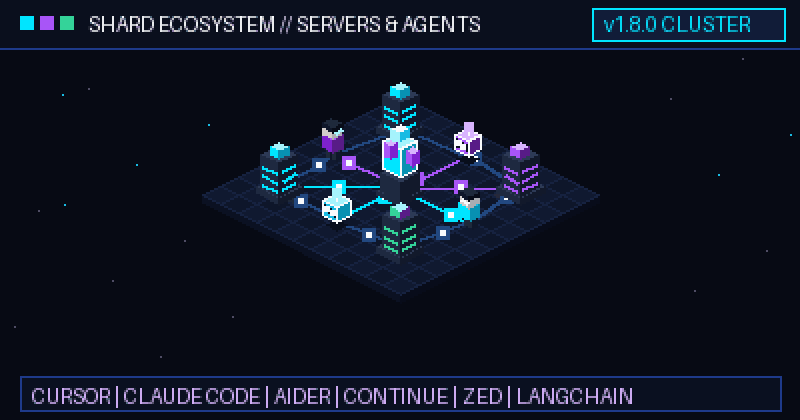
  <br>
  <sub><b>SHARD Ecosystem Topology:</b> Coding IDEs, agent frameworks, master coordinator, and distributed LAN worker nodes operating as a unified inference fabric.</sub>
</p>

### System Architecture Diagram

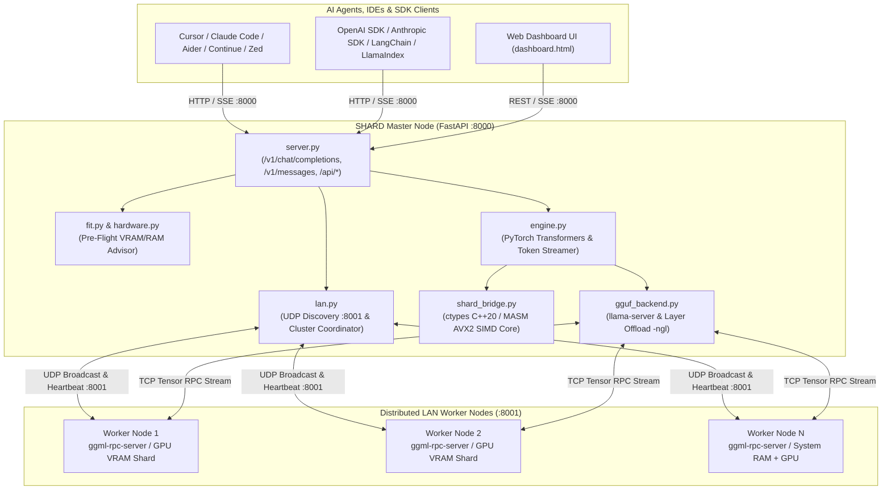

### Core Repository Modules
```text
shard/
├── assets/
│   ├── branding/              # Official SHARD SVG & PNG logos, icons, and favicon
│   ├── animations/            # Isometric pixel-art / voxel animated GIFs
│   └── screenshots/           # Dashboard and CLI fit advisor visuals
├── docs/
│   └── LAN_SHARDING_DESIGN.md # Distributed LAN sharding protocol & architecture spec
├── native/
│   ├── build_native.py        # Cross-platform compiler for C++20 & MASM AVX2 kernels
│   ├── shard_core.cpp         # C++20 RMSNorm, LayerNorm, RoPE, Softmax, GELU, SiLU, MatMul
│   ├── shard_asm.asm          # x86-64 MASM AVX2 SIMD assembly kernels
│   └── shard_gui.cpp          # Native Win32 desktop GUI wrapper
├── cli.py                     # `shard` command-line interface entry point
├── main.py                    # Application launcher & Uvicorn bootstrapper
├── server.py                  # FastAPI server (OpenAI, Anthropic, Model & LAN routes)
├── engine.py                  # Core LLM inference orchestrator & SSE generator
├── gguf_backend.py            # Managed llama.cpp / GGUF server & RPC integration
├── lan.py                     # UDP subnet discovery, node pairing & LAN resource pooling
├── fit.py                     # Pre-flight model memory & throughput calculator
├── hardware.py                # GPU VRAM (nvidia-smi), CPU & RAM probing
├── hf_hub.py                  # Hugging Face Hub search, metadata & downloader
├── shard_bridge.py            # Python ctypes bridge to native shard_core.dll / .so
├── settings.py                # Persistent configuration manager (~/.shard/settings.json)
├── dashboard.html             # Single-file web control panel & agent config generator
└── tests_shard.py             # Automated unit, API, and kernel verification suite
```

---

## Web Dashboard & Demonstrations

### Interactive Web Control Panel (`dashboard.html`)
Navigating to `http://localhost:8000` opens the built-in SHARD Control Panel:

<p align="center">
  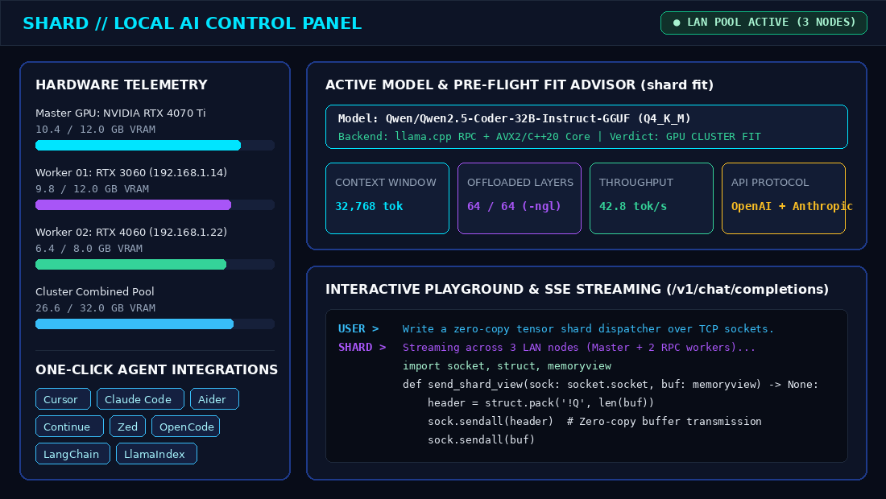
  <br>
  <sub><b>SHARD Web Dashboard:</b> Real-time per-node VRAM/RAM gauges, Pre-Flight Model Fit Advisor, one-click IDE/agent config snippets, and streaming playground.</sub>
</p>

### CLI Pre-Flight Advisor (`shard fit`) & LAN Cluster Status (`shard lan status`)

<p align="center">
  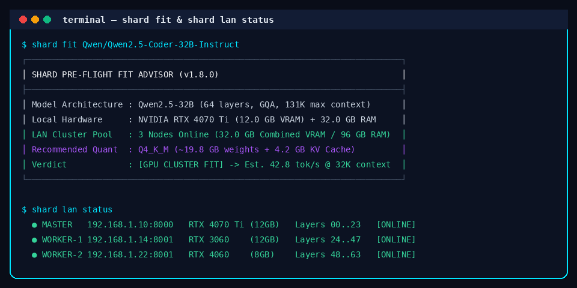
  <br>
  <sub><b>Pre-Flight Fit Verification:</b> Evaluate model quantization, context ceiling, and pooled LAN cluster fit before downloading model weights.</sub>
</p>

### Connecting AI Agents & Coding Tools
Point any OpenAI- or Anthropic-compatible client to your SHARD instance:

```python
from openai import OpenAI

client = OpenAI(
    base_url="http://localhost:8000/v1",
    api_key="shard-local",  # Or generate a token via `shard key --gen`
)

stream = client.chat.completions.create(
    model="Qwen/Qwen2.5-Coder-7B-Instruct",
    messages=[{"role": "user", "content": "Explain tensor parallelism across LAN nodes."}],
    stream=True,
)

for chunk in stream:
    if chunk.choices[0].delta.content:
        print(chunk.choices[0].delta.content, end="", flush=True)
```

---

## Project Status & Community

### Technology Stack
- **Runtime & API:** Python 3.8+ / 3.10+, [FastAPI](https://fastapi.tiangolo.com/), [Uvicorn](https://www.uvicorn.org/), [Pydantic v2](https://docs.pydantic.dev/)
- **ML & Quantization:** [PyTorch](https://pytorch.org/), Hugging Face [`transformers`](https://huggingface.co/docs/transformers), [`accelerate`](https://huggingface.co/docs/accelerate), [`safetensors`](https://huggingface.co/docs/safetensors), [`huggingface_hub`](https://huggingface.co/docs/huggingface_hub), [`llama.cpp` GGUF](https://github.com/ggml-org/llama.cpp)
- **Native Acceleration:** C++20 (`native/shard_core.cpp`) + x86-64 MASM AVX2 Assembly (`native/shard_asm.asm`)
- **System & Networking:** `psutil`, UDP broadcast discovery (`:8001`), HTTP/SSE streaming (`:8000`)

### Community, Contribution & Governance
- **Architecture & LAN Design Spec:** [`docs/LAN_SHARDING_DESIGN.md`](docs/LAN_SHARDING_DESIGN.md)
- **Contribution Guidelines:** [`CONTRIBUTING.md`](CONTRIBUTING.md) — covers zero-copy memory rules, native C++20/AVX2 build steps, and running `shard test`.
- **Code of Conduct:** [`CODE_OF_CONDUCT.md`](CODE_OF_CONDUCT.md)
- **Release History:** [`CHANGELOG.md`](CHANGELOG.md) (current release: `v1.8.0`)
- **Bug Reports & Feature Requests:** [GitHub Issues](https://github.com/avelone123123/shard/issues)
- **Community Q&A & Ideas:** [GitHub Discussions](https://github.com/avelone123123/shard/discussions)
- **Security Policy:** Please report security vulnerabilities privately via [GitHub Security Advisories](https://github.com/avelone123123/shard/security) or by contacting the maintainer before public disclosure.
- **License:** Distributed under the [MIT License](LICENSE).

---

<p align="center">
  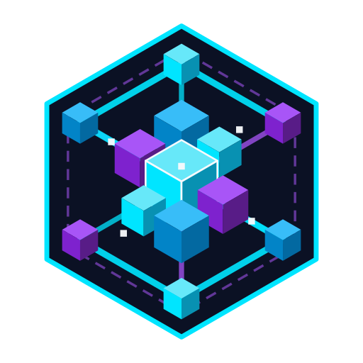<br>
  <strong>SHARD — One Network. Many Servers. Shared AI Infrastructure.</strong><br>
  <sub>Built for the open-source local AI community &middot; <a href="README.md">English</a> &middot; <a href="README.ru.md">Русский</a> &middot; <a href="README.kz.md">Қазақша</a></sub>
</p>
