<p align="center">
  <strong>English</strong> &nbsp;|&nbsp;
  <a href="README.ru.md">Русская версия</a> &nbsp;|&nbsp;
  <a href="README.kz.md">Қазақша нұсқасы</a>
</p>

<p align="center">
  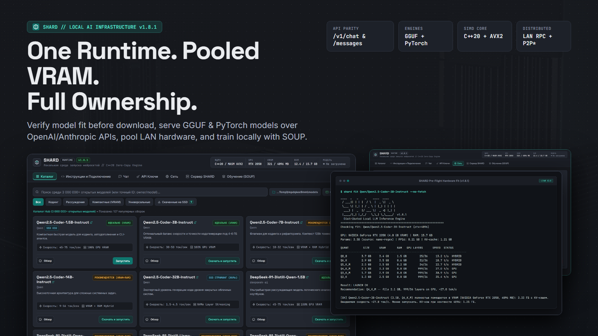
</p>

<p align="center">
  <picture>
    <source media="(prefers-color-scheme: dark)" srcset="assets/branding/shard-logo-dark.svg">
    <source media="(prefers-color-scheme: light)" srcset="assets/branding/shard-logo-light.svg">
    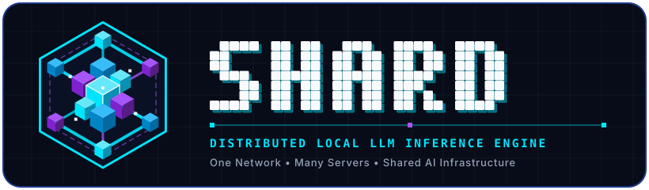
  </picture>
</p>

<h1 align="center">SHARD</h1>

<p align="center">
  <strong>Your Local AI Infrastructure.</strong><br>
  <sub>Pre-flight VRAM/RAM fit analysis, GGUF &amp; PyTorch inference, C++20/MASM AVX2 kernels, OpenAI &amp; Anthropic APIs, LAN VRAM pooling, and optional SOUP fine-tuning.</sub>
</p>

<p align="center">
  <a href="https://avelone123123.github.io/shard/"></a>
  <a href="https://pypi.org/project/shard-engine/"></a>
  <a href="https://github.com/avelone123123/shard/releases"></a>
  <a href="https://github.com/avelone123123/shard/actions/workflows/tests.yml"></a>
  <a href="LICENSE"></a>
</p>

<p align="center">
  <a href="https://github.com/avelone123123/shard/stargazers"></a>
  <a href="https://github.com/avelone123123/shard/releases"></a>
  
  
  
</p>

<p align="center">
  <a href="#overview">Overview</a> &middot;
  <a href="#demo-preview">Demo</a> &middot;
  <a href="#core-capabilities">Capabilities</a> &middot;
  <a href="#live-screenshots">Screenshots</a> &middot;
  <a href="#architecture">Architecture</a> &middot;
  <a href="#installation--quick-start">Quick Start</a> &middot;
  <a href="#cli-reference">CLI</a> &middot;
  <a href="#openai--anthropic-compatible-api">API</a> &middot;
  <a href="#lan--p2p-capabilities">LAN &amp; P2P</a> &middot;
  <a href="#soup-fine-tuning-ecosystem">SOUP Training</a> &middot;
  <a href="#roadmap">Roadmap</a>
</p>

---

## Overview

**SHARD** (`shard-engine`) is an open-source local AI inference runtime and CLI built with Python ([FastAPI](https://fastapi.tiangolo.com/)), managed `llama.cpp` GGUF serving, Hugging Face PyTorch `transformers`, and optional native C++20 / MASM x64 AVX2 SIMD kernels. Instead of guessing whether a model will out-of-memory your GPU or scattering scripts across machines, SHARD checks quantization fit before downloading, serves drop-in `/v1/*` OpenAI and Anthropic endpoints, pools subnet VRAM across LAN devices, and optionally orchestrates single-node LoRA/DPO fine-tuning with [SOUP](https://github.com/MakazhanAlpamys/Soup).

<p align="center">
  <a name="demo-preview"></a>
  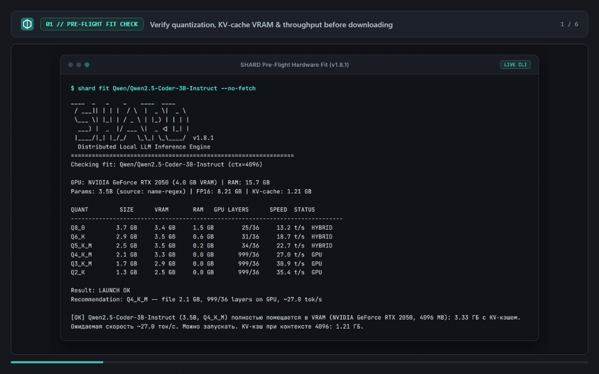
  <br>
  <sub><b>Real captured walkthrough:</b> Pre-flight hardware fit checks (<code>shard fit</code>), diagnostics (<code>shard doctor</code>), Modern Slate model catalog, IDE setup, LAN cluster controls, and SOUP training workspace.</sub>
</p>

---

## Core Capabilities

Every module listed below maps directly to verified source files in [`shard_engine/`](shard_engine/) and [`native/`](native/) (`v1.8.1`).

| Domain | Verified Capability | Source Modules | Notes |
| :--- | :--- | :--- | :--- |
| **Pre-Flight Sizing** | Hardware & Quantization Fit Advisor (`shard fit`) | [`fit.py`](shard_engine/fit.py), [`hardware.py`](shard_engine/hardware.py) | Computes `GPU`, `HYBRID`, or `IMPOSSIBLE` verdicts, KV-cache sizing, disk-space checks, and estimated `tok/s` from `config.json` or regex heuristics before downloading. |
| **Dual Runtime** | GGUF (`llama.cpp`) & PyTorch SafeTensors | [`gguf_backend.py`](shard_engine/gguf_backend.py), [`engine.py`](shard_engine/engine.py), [`hf_hub.py`](shard_engine/hf_hub.py) | Auto-manages `llama-server` / `ggml-rpc-server` with layer offload (`-ngl`), or loads Hugging Face SafeTensors & LoRA adapters via `transformers`. |
| **SIMD Acceleration** | C++20 & x86-64 MASM AVX2 Kernels (98 specs) | [`native/shard_core.cpp`](native/shard_core.cpp), [`native/shard_asm.asm`](native/shard_asm.asm), [`shard_bridge.py`](shard_engine/shard_bridge.py) | Accelerated `RMSNorm`, `LayerNorm`, `RoPE`, `Softmax`, `GELU`, `SiLU`, and `MatMul` loaded via `ctypes` with automatic pure-Python fallback. |
| **API & Hosting** | OpenAI & Anthropic Compatible Server | [`server.py`](shard_engine/server.py), [`session_registry.py`](shard_engine/session_registry.py) | Exposes `/v1/chat/completions`, `/v1/completions`, `/v1/models`, `/v1/messages`, `/v1/messages/count_tokens`, owner-gated `/api/*`, and salted SHA-256 private chat sessions. |
| **Workstation UI** | Embedded Modern Slate Web Dashboard | [`dashboard.html`](shard_engine/dashboard.html) | Dark slate interface on `:8000` with live VRAM/RAM gauges, model browser, chat playground, API key management, IDE integration scripts, and LAN/SOUP controls. |
| **LAN Memory Pool** | UDP Discovery (`:8001`) & Worker Compute Quotas | [`lan.py`](shard_engine/lan.py), [`docs/LAN_SHARDING_DESIGN.md`](docs/LAN_SHARDING_DESIGN.md) | Pairs subnet nodes via `XXXX-XXXX` code or `--open`, tracks 1s heartbeats, enforces worker VRAM/CPU quotas, and launches `ggml-rpc-server` workers. |
| **Global P2P & Relay** | Cryptographic Node ID & Encrypted Relay *(Experimental)* | [`net_identity.py`](shard_engine/net_identity.py), [`net_tunnel.py`](shard_engine/net_tunnel.py), [`net_discovery.py`](shard_engine/net_discovery.py), [`net_strategy.py`](shard_engine/net_strategy.py) | **Experimental:** Ed25519 Node ID (`shn_*`), X25519 + ChaCha20-Poly1305 AEAD frames, STUN/UDP punch probes, WireGuard status plans, and self-hostable `discovery-serve` / `relay-serve`. |
| **SOUP Training** | Consent Feedback & Local Fine-Tuning *(Optional)* | [`feedback.py`](shard_engine/feedback.py), [`soup_adapter.py`](shard_engine/soup_adapter.py), [`training.py`](shard_engine/training.py) | Single-node SFT/DPO fine-tuning with explicit consent, API-key/PII redaction, dry-run validation, job cancel/resume, evaluation, deploy & 1-click rollback. |
| **Windows Reliability** | Binary Subprocess I/O & Hardened Updater | [`proc_io.py`](shard_engine/proc_io.py), [`updater.py`](shard_engine/updater.py) | Eliminates Windows `charmap`/`cp1251` `_readerthread` crashes on UTF-8/OEM subprocess output and rejects placeholder/unverified update metadata. |

---

## Live Screenshots

All screenshots below are captured directly from a local SHARD `v1.8.1` runtime with Modern Slate UI and real CLI execution (host paths and private IPs sanitized for public documentation).

<table>
  <tr>
    <td width="50%" valign="top">
      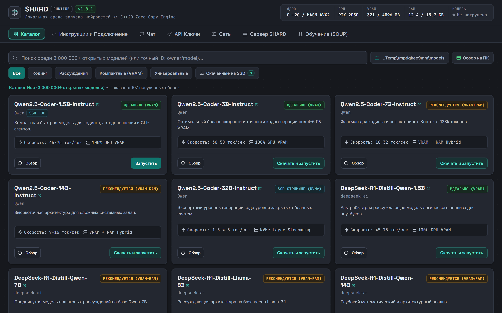
      <br><sub><b>Model Catalog &amp; Live Hardware Telemetry:</b> Real-time GPU/VRAM/RAM bars and per-model fit verdicts (<code>IDEAL (VRAM)</code>, <code>HYBRID</code>, <code>SSD STREAMING</code>).</sub>
    </td>
    <td width="50%" valign="top">
      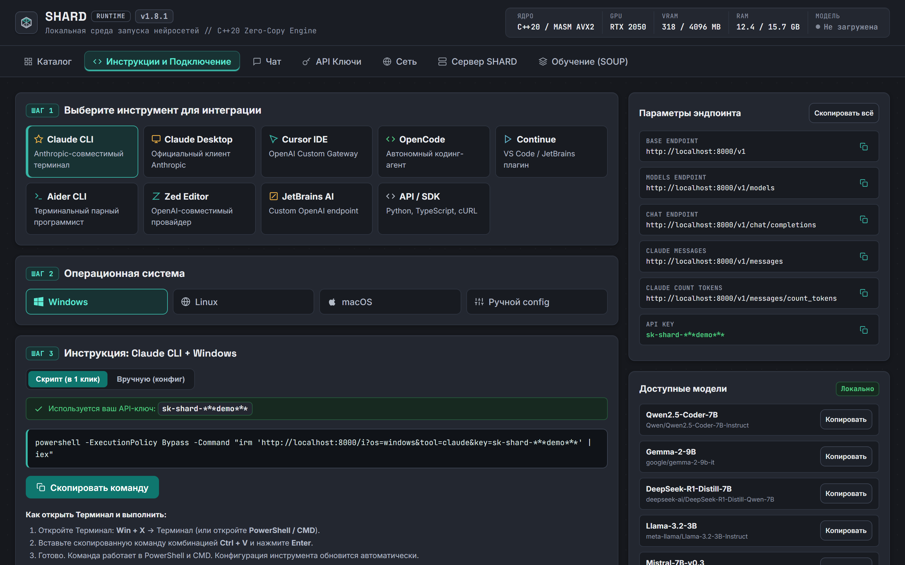
      <br><sub><b>Agent &amp; IDE Integration Generator:</b> Instant setup commands and endpoints for Claude Code, Cursor IDE, Aider, Continue, Zed, OpenCode, and raw SDKs.</sub>
    </td>
  </tr>
  <tr>
    <td width="50%" valign="top">
      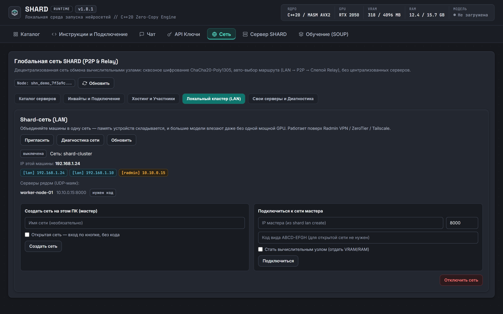
      <br><sub><b>LAN Compute Cluster &amp; Network Tab:</b> Create/join subnet pools, toggle compute worker sharing, inspect nearby UDP beacons, and switch to experimental P2P settings.</sub>
    </td>
    <td width="50%" valign="top">
      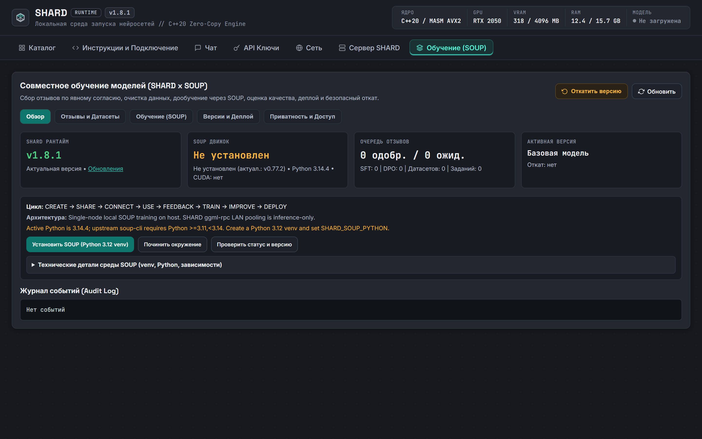
      <br><sub><b>Collaborative Training Studio (SHARD x SOUP):</b> Reviews SOUP runtime status, feedback moderation queues, dataset builds, and single-node Python version guidance.</sub>
    </td>
  </tr>
  <tr>
    <td width="50%" valign="top">
      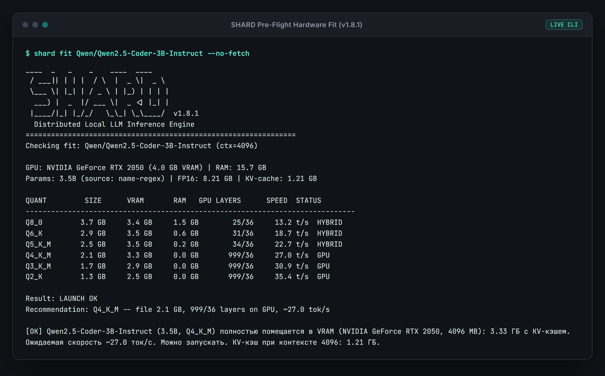
      <br><sub><b>Pre-Flight Fit CLI (<code>shard fit</code>):</b> Evaluates quantization tiers (<code>Q8_0</code> down to <code>Q2_K</code>), VRAM/RAM split, GPU layer count, and speed estimate prior to download.</sub>
    </td>
    <td width="50%" valign="top">
      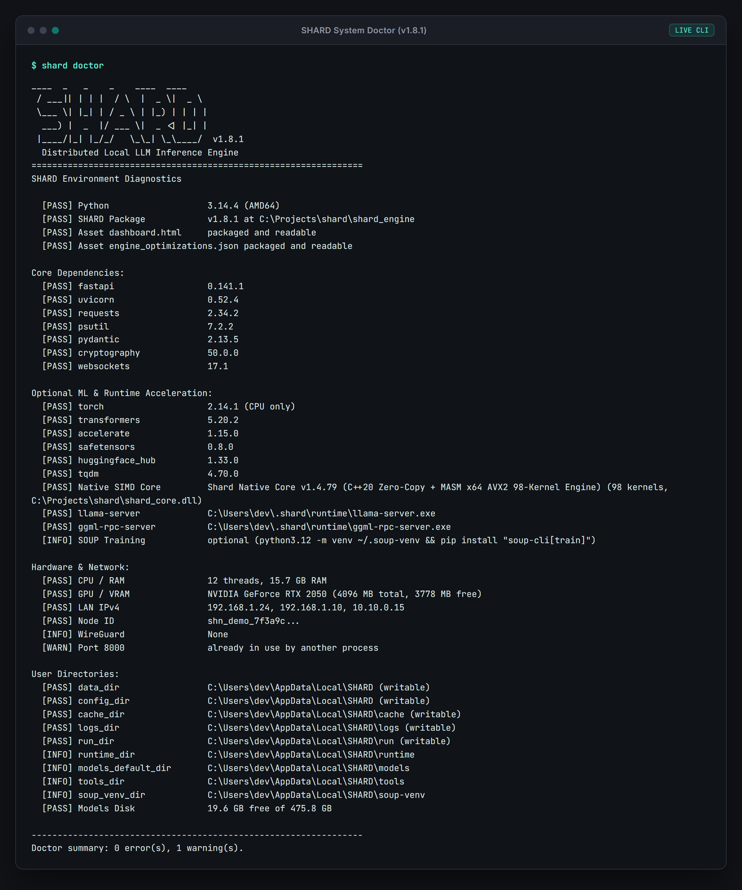
      <br><sub><b>System Diagnostics (<code>shard doctor</code>):</b> Audits Python runtime, FastAPI/ML packages, C++20/AVX2 98-kernel DLL, GGUF binaries, GPU VRAM, ports, and writable directories.</sub>
    </td>
  </tr>
</table>

---

## Architecture

<p align="center">
  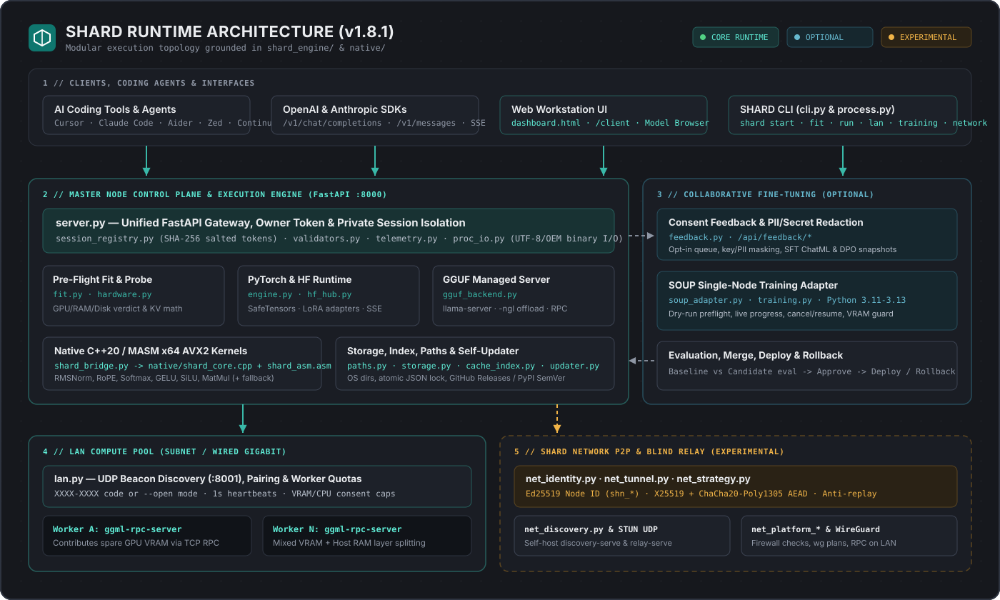
</p>

---

## How SHARD Works

<p align="center">
  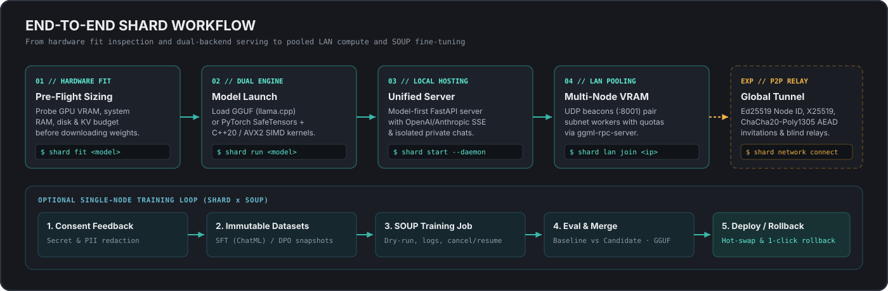
</p>

1. **Pre-Flight Sizing (`fit.py` + `hardware.py`)**: Inspects host GPU VRAM, free system RAM, disk budget, and model architecture metadata before fetching large weights, reserving `400 MB` VRAM and `2048 MB` RAM headroom by default.
2. **Engine Selection (`gguf_backend.py` or `engine.py`)**: Routes quantized `.gguf` models through managed `llama-server` binaries with computed `-ngl` GPU layer offload, or loads Hugging Face SafeTensors / LoRA adapters directly in PyTorch.
3. **API & Hosted Workspace (`server.py` + `session_registry.py`)**: Serves standard OpenAI and Anthropic endpoints on `:8000` while isolating multi-user chat history under salted SHA-256 server-issued session tokens and blocking server publishing if no model is loaded (`HTTP 409 MODEL_NOT_READY`).
4. **LAN Pooling & Experimental P2P (`lan.py`, `net_*`)**: Broadcasts UDP beacons (`:8001`) so subnet workers can contribute spare memory over `ggml-rpc-server`. Optional cryptographic P2P / Blind Relay modules remain clearly isolated as experimental.
5. **SOUP Improvement Loop (`feedback.py` + `soup_adapter.py` + `training.py`)**: Redacts secrets/PII from consented feedback, freezes immutable `SFT` / `DPO` dataset snapshots, trains on the single host GPU/CPU via `soup-cli`, compares candidate vs baseline outputs, and deploys or rolls back in one command.

---

## Installation & Quick Start

### Option 1: Install from PyPI

```bash
# Core runtime: CLI, FastAPI server, web dashboard, GGUF (llama.cpp), and LAN clustering
pip install shard-engine

# Full ML extras: adds PyTorch Transformers, accelerate, safetensors, and huggingface_hub telemetry
pip install "shard-engine[full]"

# Optional SOUP collaborative training integration (supported on Python 3.11 - 3.13)
pip install "shard-engine[training]"
```

Verify your environment immediately after installing:

```bash
shard doctor
```

> **Windows Note:** If `shard` is not in your shell `PATH`, run any command via `python -m shard_engine <command>`. For CUDA acceleration with the `[full]` extra, install the matching CUDA build of `torch` before running GGUF/PyTorch workloads. GGUF inference auto-downloads `llama-server` and `ggml-rpc-server` on first use.

### Option 2: Editable Development Install

```bash
git clone https://github.com/avelone123123/shard.git
cd shard
pip install -e ".[dev]"

# Optional: compile C++20 / MASM x64 AVX2 native kernels (Windows MSVC or Linux GCC/Clang)
python native/build_native.py
```

### Option 3: Docker Compose

```bash
# Local GPU server stack
docker compose up --build

# Self-hosted experimental SHARD Network Discovery & Blind Relay nodes
docker compose -f docker-compose.network.yml up -d
```

---

## CLI Reference

Every command below is implemented in [`shard_engine/cli.py`](shard_engine/cli.py).

```bash
# Check hardware, dependencies, ports, runtime binaries, and storage directories
shard doctor

# Predict quantization fit and throughput before downloading
shard fit Qwen/Qwen2.5-Coder-3B-Instruct

# Download (if needed) and start an interactive terminal chat REPL
shard run Qwen/Qwen2.5-Coder-1.5B-Instruct

# Start FastAPI server & Modern Slate dashboard (background daemon or foreground)
shard start --daemon
shard status
shard stop

# Manage local API tokens & model storage root
shard key --gen
shard models-dir D:\shard-models

# Verify C++20/AVX2 SIMD kernels and fallback parity, check GitHub/PyPI releases
shard test
shard update --check
```

<details>
<summary>Full CLI Command Groupings (<code>shard --help</code>)</summary>

| Command | Purpose |
| :--- | :--- |
| `shard start\|stop\|restart\|status\|gui` | Manage FastAPI/Uvicorn server lifecycle, PID tracking, hardware summary, and optional Windows native wrapper. |
| `shard list\|fit\|run\|models-dir\|key` | Browse curated & cached models, run pre-flight quantization plans, stream terminal chat, manage storage and API keys. |
| `shard lan status\|create\|join\|invite\|diagnose\|model\|off` | Create or join LAN/VPN compute pools with `--open` or `XXXX-XXXX` pairing codes, set target model, and contribute `--share` VRAM/RAM. |
| `shard training status\|doctor\|feedback\|privacy\|dataset\|start\|logs\|cancel\|resume\|models\|eval\|prepare\|approve\|deploy\|rollback\|backup\|restore\|prune` | Manage explicit consent feedback, dataset snapshots, SOUP training jobs, evaluation, model deployment, and rollback. |
| `shard network status\|identity\|config\|servers\|publish\|unpublish\|connect\|disconnect\|invite\|peers\|approve\|reject\|kick\|block\|wg\|discovery-serve\|relay-serve\|doctor` | Inspect cryptographic node identity and manage **experimental** P2P discovery, Blind Relay tunnels, invites, peer quotas, and WireGuard plans. |
| `shard doctor\|test\|update\|version\|help` | Diagnose environment health, benchmark SIMD/fallback kernels, verify SemVer updates, and print runtime paths. |

</details>

---

## OpenAI & Anthropic Compatible API

When `shard start` is active (`http://127.0.0.1:8000` by default), connect standard SDKs or coding agents (Claude Code, Cursor, Aider, Continue, Zed, OpenCode, LangChain):

### OpenAI Python SDK (`/v1/chat/completions`)

```python
from openai import OpenAI

client = OpenAI(
    base_url="http://localhost:8000/v1",
    api_key="shard-local",
)

stream = client.chat.completions.create(
    model="Qwen/Qwen2.5-Coder-3B-Instruct",
    messages=[{"role": "user", "content": "Explain how GGUF -ngl offload works."}],
    stream=True,
)

for chunk in stream:
    delta = chunk.choices[0].delta.content
    if delta:
        print(delta, end="", flush=True)
```

### Anthropic Messages API (`/v1/messages`)

```bash
curl -X POST http://localhost:8000/v1/messages \
  -H "Content-Type: application/json" \
  -H "x-api-key: shard-local" \
  -d '{
    "model": "Qwen/Qwen2.5-Coder-3B-Instruct",
    "max_tokens": 256,
    "messages": [{"role": "user", "content": "Summarize SHARD pre-flight fit checks."}]
  }'
```

Key protocol endpoints implemented in [`shard_engine/server.py`](shard_engine/server.py):
- Inference: `/v1/models`, `/v1/ping`, `/v1/chat/completions`, `/v1/completions`, `/v1/messages`, `/v1/messages/count_tokens`
- IDE bootstrapper: `/i` (auto-generates client setup snippets in `dashboard.html`)
- Telemetry & Fit: `/api/system/hardware`, `/api/system/update`, `/api/fit/{model_id}`, `/api/models/*`, `/api/engine/status`
- Private Server Sessions: `/api/server/session`, `/api/server/session/revoke`, `/api/server/chats`, `/api/server/workspace`

---

## Backends, Models & Native Acceleration

- **GGUF Backend (`llama.cpp`)** — Managed by [`shard_engine/gguf_backend.py`](shard_engine/gguf_backend.py). Automatically downloads platform binaries (`llama-server`, `ggml-rpc-server`), parses quantization families (`Q8_0` through `Q2_K` and `IQ*`), groups multi-part GGUF splits, and sets GPU layer offload (`-ngl`) from `fit.py`.
- **PyTorch / Transformers Backend** — Managed by [`shard_engine/engine.py`](shard_engine/engine.py) and [`shard_engine/hf_hub.py`](shard_engine/hf_hub.py). Loads local SafeTensors directories or Hugging Face repos, tracks `tqdm` download progress telemetry, supports PEFT LoRA adapter deployment, and integrates with `shard_bridge`.
- **Native SIMD Core (`native/`)** — [`native/shard_core.cpp`](native/shard_core.cpp) + [`native/shard_asm.asm`](native/shard_asm.asm) implement 98 verified tensor kernel specifications across C++20 SIMD and x86-64 MASM AVX2/FMA (`RMSNorm`, `LayerNorm`, `RoPE`, `Softmax`, `GELU`, `SiLU`, `MatMul`). Automatically falls back to pure Python / NumPy / PyTorch when no compiled shared library is present.

---

## Hardware Requirements

| Tier | Recommended Hardware | Capability |
| :--- | :--- | :--- |
| **Minimum (CPU / Small Quant)** | Windows 10/11, Linux, or macOS · Python 3.8–3.14 · 8–16 GB RAM · x86-64 AVX2 or Apple Silicon | Runs compact `1.5B–3B` GGUF models (`HYBRID` or CPU inference) and full Web Dashboard / API server. |
| **Recommended GPU Workstation** | NVIDIA GPU with 4–12+ GB VRAM (CUDA drivers) · 16–32 GB RAM · NVMe SSD | Runs `3B–14B` models at full `GPU` or `HYBRID` speed with low-latency SSE streaming and optional single-node SOUP training. |
| **Multi-Node LAN Cluster** | 2+ computers on wired Gigabit / 2.5GbE LAN with ports `8000` (HTTP) and `8001` (UDP discovery + RPC) | Pools spare VRAM across heterogeneous machines via `ggml-rpc-server` to load larger quantized models (reserving `400 MB` VRAM and `2048 MB` RAM per host). |

---

## LAN & P2P Capabilities

SHARD clearly separates its stable subnet clustering workflow from newer P2P networking subsystems:

### Implemented LAN Compute Pooling ([`lan.py`](shard_engine/lan.py))
- Permanent UDP discovery listener on port `8001` announces active LAN masters and detects peers across subnet / VPN interfaces.
- Supports both `XXXX-XXXX` pairing codes and `--open` trusted-subnet auto-join, 1-second worker heartbeats with automatic stale-member drop, and explicit compute worker quotas (`/api/lan/compute/consent`).
- Best suited for trusted wired Gigabit/2.5GbE LAN subnets; WAN or high-latency Wi-Fi links increase inter-token synchronization delay across `ggml-rpc-server`.

```bash
# Master machine
shard lan create --open --share --model Qwen/Qwen2.5-Coder-7B-Instruct

# Worker machine on the same subnet
shard lan join <MASTER_IP> --share
shard lan status
```

### Experimental SHARD Network P2P & Blind Relay ([`docs/SHARD_NETWORK.md`](docs/SHARD_NETWORK.md))
> **Experimental Status:** Cross-network P2P NAT traversal, automated firewall helpers, Blind Relay routing, and WireGuard orchestration are under active field validation and should be evaluated in trusted environments rather than treated as mature production WAN infrastructure.

- **Cryptographic Identity (`net_identity.py`)**: Ed25519 Node IDs (`shn_*`), ephemeral X25519 key exchange, and ChaCha20-Poly1305 AEAD frames (`net_tunnel.py`) with monotonic anti-replay sequence counters.
- **Discovery & Self-Hosted Relays (`net_discovery.py`, `net_strategy.py`)**: Resolution priority attempts `same_machine -> direct_lan -> direct_p2p (STUN/UDP) -> encrypted relay`. You can self-host standalone infrastructure via `shard network discovery-serve` and `shard network relay-serve`.
- **Strict Isolation Invariant**: Tunnel peers receive authenticated `/v1/*` inference access and isolated private workspace chats (`session_registry.py`), while `/api/*` host owner controls remain blocked (`HTTP 403`) to remote peers.

---

## SOUP Fine-Tuning Ecosystem

SHARD optionally integrates with [`soup-cli`](https://github.com/MakazhanAlpamys/Soup) (`docs/COLLABORATIVE_TRAINING.md`) for closed-loop local model customization:

```text
Consent Feedback -> Secret/PII Redaction -> SFT / DPO Snapshot -> SOUP Train -> Eval -> Deploy / 1-Click Rollback
```

- **Honest Boundaries**: Fine-tuning executes strictly on the **single SHARD host machine** (`shard training`); SHARD's LAN `ggml-rpc` pool is inference-only. Because upstream `soup-cli` currently requires Python `>=3.11,<3.14`, Python `3.14+` hosts point `SHARD_SOUP_PYTHON` (or `SHARD_SOUP_CMD`) to a Python `3.12` venv containing `soup-cli[train]`.
- **Safety & Privacy**: Normal chat requests are never stored for training without explicit consent; secrets (`sk-*`, AWS/GitHub tokens, JWTs, PEM blocks) and PII are redacted prior to disk persistence; participants can inspect or revoke their contributions via `/api/feedback/my` and `/api/feedback/revoke`.

---

## Showcase & Promo Video Assets

Reproducible brand graphics, SVG architecture schematics, real captured screenshots, and the vertical `1080x1920` `30fps` promotional video live in this repository:
- Promotional MP4 (`1080x1920` H.264 + AAC): [`artifacts/SHARD_promo.mp4`](artifacts/SHARD_promo.mp4)
- Video Remotion composition & audio synthesis sources: [`video/`](video/)
- Showcase audit & media verification report: [`SHARD_SHOWCASE_REPORT.md`](SHARD_SHOWCASE_REPORT.md)

---

## Roadmap

- **Dynamic LAN Re-Sharding on Dropout**: Automatic layer rebalancing when a pooled worker node disconnects mid-session ([`docs/LAN_SHARDING_DESIGN.md`](docs/LAN_SHARDING_DESIGN.md)).
- **ARM64 / Apple Silicon NEON SIMD Kernels**: Extending [`native/`](native/) native routines beyond x86-64 AVX2/FMA.
- **Hardening Experimental WAN P2P & Relay Paths**: Real-world cross-NAT punch validation, relay throughput tuning, and operator observability before removing the experimental designation.
- **Multi-Node Training Exploration**: Evaluating distributed LoRA orchestration outside single-host SOUP runs.

---

## Contributing

Contributions are welcome. Please review [`CONTRIBUTING.md`](CONTRIBUTING.md) and [`CODE_OF_CONDUCT.md`](CODE_OF_CONDUCT.md) before opening a pull request. Always verify changes locally against the full test suite:

```bash
python -m unittest discover -s . -p "tests_*.py" -v
```

For Windows kernel builds, follow the MSVC (`cl.exe` + `ml64.exe`) and zero-copy buffer guidelines in [`CONTRIBUTING.md`](CONTRIBUTING.md). Report security vulnerabilities privately through [GitHub Security Advisories](https://github.com/avelone123123/shard/security).

---

## License

SHARD is distributed under the [MIT License](LICENSE).

---

## Documentation & Links

- **Official Website**: https://avelone123123.github.io/shard/
- **PyPI Package**: https://pypi.org/project/shard-engine/
- **Architecture & LAN Spec**: [`docs/LAN_SHARDING_DESIGN.md`](docs/LAN_SHARDING_DESIGN.md)
- **Experimental P2P & Relay Spec**: [`docs/SHARD_NETWORK.md`](docs/SHARD_NETWORK.md)
- **Collaborative SOUP Training Guide**: [`docs/COLLABORATIVE_TRAINING.md`](docs/COLLABORATIVE_TRAINING.md)
- **Native Benchmarks**: [`docs/BENCHMARKS.md`](docs/BENCHMARKS.md)
- **Changelog**: [`CHANGELOG.md`](CHANGELOG.md)
- **Translations**: [English](README.md) &middot; [Русский](README.ru.md) &middot; [Қазақша](README.kz.md)
