<p align="center">
  <a href="https://avelone123123.github.io/shard/"></a>
  <a href="README.md">English</a> &nbsp;|&nbsp;
  <strong>Русская версия</strong> &nbsp;|&nbsp;
  <a href="README.kz.md">Қазақша нұсқасы</a>
</p>

<p align="center">
  <picture>
    <source media="(prefers-color-scheme: dark)" srcset="assets/branding/shard-logo-dark.svg">
    <source media="(prefers-color-scheme: light)" srcset="assets/branding/shard-logo-light.svg">
    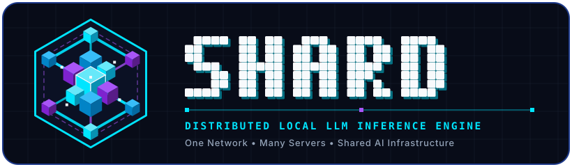
  </picture>
</p>

<h1 align="center">SHARD</h1>

<p align="center">
  <strong>Одна сеть. Множество серверов. Общая ИИ-инфраструктура.</strong><br>
  <sub>Распределённый движок локального запуска LLM, объединяющий видеопамять (VRAM) и оперативную память (RAM) компьютеров в локальной сети (LAN) на базе PyTorch, FastAPI, <code>llama.cpp</code> RPC и нативных ядер C++20 / MASM AVX2 SIMD.</sub>
</p>

<p align="center">
  <a href="README.md"></a>
  <a href="README.ru.md"></a>
  <a href="README.kz.md"></a>
  <a href="docs/LAN_SHARDING_DESIGN.md"></a>
  <a href="#установка-и-быстрый-старт"></a>
  <a href="#установка"></a>
  <a href="https://github.com/avelone123123/shard/discussions"></a>
  <a href="https://github.com/avelone123123/shard/issues"></a>
  <a href="https://github.com/avelone123123/shard/releases"></a>
</p>

<p align="center">
  <a href="https://github.com/avelone123123/shard/releases"></a>
  <a href="https://github.com/avelone123123/shard/releases/latest"></a>
  <a href="https://github.com/avelone123123/shard/stargazers"></a>
  <a href="https://www.python.org/"></a>
  <a href="LICENSE"></a>
  <a href="https://github.com/avelone123123/shard/actions/workflows/tests.yml"></a>
  
  
</p>

<p align="center">
  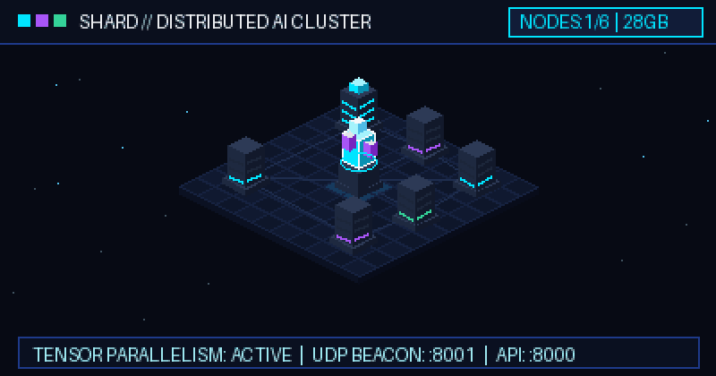
  <br>
  <sub><b>Кластер распределённого вывода SHARD:</b> Центральный узел-координатор объединяет видеопамять рабочих узлов локальной сети через UDP-обнаружение (<code>:8001</code>) и потоковый FastAPI SSE-сервер (<code>:8000</code>).</sub>
</p>

<p align="center">
  <a href="#что-такое-shard">О проекте</a> &middot;
  <a href="#как-работает-shard">Как это работает</a> &middot;
  <a href="#возможности">Возможности</a> &middot;
  <a href="#установка-и-быстрый-старт">Быстрый старт</a> &middot;
  <a href="#справочник-cli-и-конфигурация">Команды CLI</a> &middot;
  <a href="#архитектура">Архитектура</a> &middot;
  <a href="#веб-панель-и-демонстрация">Веб-панель</a> &middot;
  <a href="#статус-проекта-и-сообщество">Сообщество</a>
</p>

---

## Что такое SHARD?

**[SHARD](https://github.com/avelone123123/shard)** (`shard-engine`) — это открытый распределённый движок для локального запуска больших языковых моделей (LLM), написанный на Python ([FastAPI](https://fastapi.tiangolo.com/) + [PyTorch](https://pytorch.org/)) с поддержкой бэкенда [GGUF / `llama.cpp`](https://github.com/ggml-org/llama.cpp) и нативного аппаратного ускорения на C++20 и MASM AVX2 SIMD.

### Какую проблему он решает
Запуск современных открытых моделей на 14B, 32B или 70B+ параметров на локальном оборудовании почти всегда упирается в **ограничение видеопамяти (VRAM) одной видеокарты**. При этом у многих разработчиков и команд в одной локальной сети есть сразу несколько устройств — рабочий ПК с GPU, ноутбук, дополнительный сервер или мини-ПК, чья память остаётся разрозненной.

### Зачем создан SHARD
SHARD объединяет свободные ресурсы GPU и RAM нескольких компьютеров в вашей локальной сети (LAN) в единый вычислительный пул:
- **Объединение памяти без облаков:** Распределяйте слои трансформера между несколькими пользовательскими видеокартами и ОЗУ по обычной гигабитной сети (`lan.py`, `gguf_backend.py`) без платных API и передачи данных на внешние серверы.
- **Предварительная оценка совместимости (`shard fit`):** Ещё до скачивания многогигабайтных весов проверьте, поместится ли модель на вашу видеокарту, в гибридный режим CPU+GPU или в объединённый LAN-кластер (`fit.py`).
- **Полная совместимость с ИИ-агентами и IDE:** Сервер поднимает стандартные эндпоинты OpenAI (`/v1/chat/completions`, `/v1/completions`, `/v1/models`) и Anthropic (`/v1/messages`) на порту `8000`.

### Кому подойдёт SHARD?
- **Разработчикам и исследователям ИИ**, запускающим модели 7B–70B в форматах GGUF или SafeTensors на домашнем или лабораторном оборудовании.
- **Инженерным командам**, разворачивающим приватных локальных ИИ-ассистентов для [Cursor](https://www.cursor.com/), [Claude Code](https://docs.anthropic.com/en/docs/agents-and-tools/claude-code/overview), [Aider](https://aider.chat/), [Continue](https://www.continue.dev/), [Zed](https://zed.dev/) и [OpenCode](https://github.com/opencode-ai/opencode).
- **Создателям ИИ-агентов**, использующим [OpenAI Python SDK](https://github.com/openai/openai-python), [LangChain](https://www.langchain.com/) или [LlamaIndex](https://www.llamaindex.ai/) поверх собственной инфраструктуры.

---

## Как работает SHARD

Архитектура SHARD строится вокруг четырёх наглядных шагов: **СОЗДАНИЕ → ПУБЛИКАЦИЯ → ПОДКЛЮЧЕНИЕ → ИСПОЛЬЗОВАНИЕ**.

<table>
  <tr>
    <td width="50%" valign="top">
      <h3 align="center">1. CREATE — Запустите свой сервер</h3>
      <p align="center">
        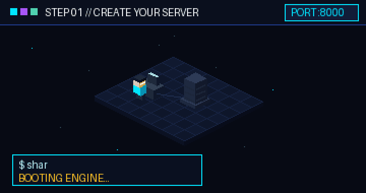
      </p>
      <p>
        Запустите узел командой <code>shard start</code> или <code>python main.py</code>. Модуль <code>hardware.py</code> автоматически определит характеристики CPU, объём RAM и наличие GPU (NVIDIA CUDA / Apple MPS), загрузит выбранную модель GGUF или Hugging Face и откроет API и веб-интерфейс по адресу <code>http://localhost:8000</code>.
      </p>
    </td>
    <td width="50%" valign="top">
      <h3 align="center">2. SHARE — Откройте доступ в сети</h3>
      <p align="center">
        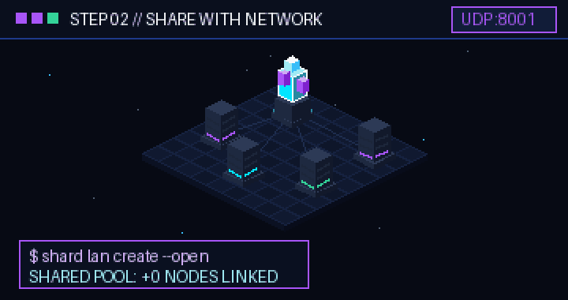
      </p>
      <p>
        Создайте вычислительный пул командой <code>shard lan create --open</code> (или защитите подключение кодом через <code>shard lan create</code>). SHARD рассылает широковещательные UDP-маяки на порту <code>8001</code> и активирует маршруты <code>/api/lan/*</code> для объединения памяти узлов.
      </p>
    </td>
  </tr>
  <tr>
    <td width="50%" valign="top">
      <h3 align="center">3. CONNECT — Подключите рабочие узлы</h3>
      <p align="center">
        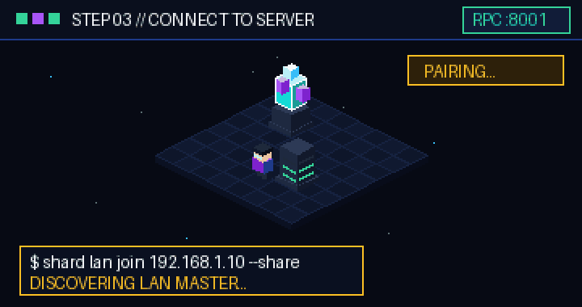
      </p>
      <p>
        На любом другом компьютере в локальной сети выполните <code>shard lan join &lt;IP-мастера&gt; --share</code>. Рабочий узел проходит авторизацию (<code>POST /api/lan/pair</code>), запускает локальный RPC-воркер, отправляет телеметрию состояния и передаёт свои ресурсы GPU/RAM в общий пул.
      </p>
    </td>
    <td width="50%" valign="top">
      <h3 align="center">4. USE — Подключайте ИИ-агентов</h3>
      <p align="center">
        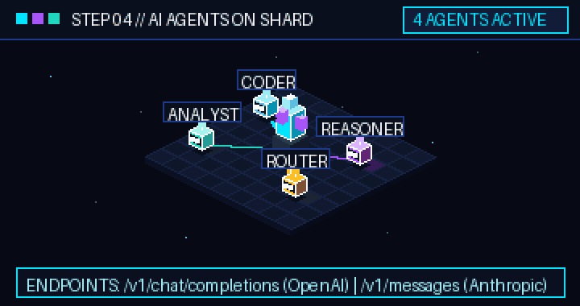
      </p>
      <p>
        Направьте IDE, автономных агентов или собственные сервисы на <code>http://&lt;IP-мастера&gt;:8000/v1/chat/completions</code> или <code>/v1/messages</code>. Главный узел распределяет вычисление слоёв по сети и транслирует токены в реальном времени через Server-Sent Events (SSE).
      </p>
    </td>
  </tr>
</table>

---

## Возможности

Все перечисленные ниже функции проверены по актуальному исходному коду репозитория [SHARD](https://github.com/avelone123123/shard) (`v1.8.0`).

### Реализованные возможности

| Категория | Функция | Модуль исходного кода | Описание |
| :--- | :--- | :--- | :--- |
| **LAN-кластер и шардинг** | **Автообнаружение по UDP и пулинг памяти** | [`lan.py`](lan.py), [`docs/LAN_SHARDING_DESIGN.md`](docs/LAN_SHARDING_DESIGN.md) | Рассылка UDP-маяков (`:8001`), сопряжение по коду или в открытом режиме (`--open`), мониторинг пульса узлов (`/api/lan/heartbeat`) и объединение VRAM/RAM. |
| **Бэкенды вывода** | **Двойной движок PyTorch и GGUF (`llama.cpp`)** | [`engine.py`](engine.py), [`gguf_backend.py`](gguf_backend.py) | Запуск моделей Hugging Face (`transformers` / `safetensors`) на CUDA/CPU/MPS и квантованных моделей GGUF через `llama-server` и `ggml-rpc-server` с настройкой выгрузки слоёв на GPU (`-ngl`). |
| **Оценка оборудования** | **Советник совместимости (`shard fit`)** | [`fit.py`](fit.py), [`hardware.py`](hardware.py) | Анализирует параметры архитектуры модели до скачивания весов, выдаёт вердикт (`GPU`, `HYBRID`, `IMPOSSIBLE`), максимальный контекст, оценку скорости (tok/s) и рекомендуемое квантование. |
| **Нативное ускорение** | **Ядра C++20 и MASM AVX2 SIMD** | [`native/shard_core.cpp`](native/shard_core.cpp), [`native/shard_asm.asm`](native/shard_asm.asm), [`shard_bridge.py`](shard_bridge.py) | Низкоуровневые реализации `RMSNorm`, `LayerNorm`, поворотных эмбеддингов (`RoPE`), `Softmax`, `GELU`, `SiLU` и `MatMul` с векторизацией AVX2, подключаемые через `ctypes`. |
| **API и стриминг** | **Совместимость с OpenAI и Anthropic API** | [`server.py`](server.py) | Поддержка `/v1/chat/completions`, `/v1/completions`, `/v1/models`, `/v1/messages` (протокол Anthropic), `/api/generate` и `/api/generate/stream` (SSE) с защитой API-ключами (`shard key`). |
| **Веб-управление** | **Автономная панель управления (`dashboard.html`)** | [`dashboard.html`](dashboard.html) | Веб-интерфейс на `http://localhost:8000` с мониторингом VRAM/RAM, поиском и загрузкой моделей с Hugging Face, интерактивным чатом, управлением LAN-пулом и готовыми конфигами для IDE. |
| **Контейнеризация** | **Стек Docker и NVIDIA GPU Compose** | [`Dockerfile`](Dockerfile), [`docker-compose.yml`](docker-compose.yml) | Готовая конфигурация контейнера с постоянными томами (`shard_models_volume`, `shard_data_volume`) и пробросом GPU NVIDIA. |
| **Совместное обучение** | **Опциональный конвейер дообучения (SOUP)** | [`soup_adapter.py`](shard_engine/soup_adapter.py), [`feedback.py`](shard_engine/feedback.py), [`training.py`](shard_engine/training.py), [`docs/COLLABORATIVE_TRAINING.ru.md`](docs/COLLABORATIVE_TRAINING.ru.md) | Сбор отзывов с явным согласием, очистка секретов/ПДн, снимки SFT/DPO, запуск обучения через SOUP, оценка Baseline vs Candidate, версионирование, деплой и откат. |

### Экспериментальные возможности
- **Межсетевой RPC-шардинг слоёв `llama.cpp` (`gguf_backend.py`, `lan.py`):** Распределённое выполнение слоёв по TCP/RPC между разными видеокартами в LAN показывает максимальную скорость в проводных сетях Gigabit / 2.5GbE Ethernet; при работе по Wi-Fi возможны задержки передачи тензоров.
- **Нативный графический интерфейс Win32 (`native/shard_gui.cpp`):** Локальная десктопная оболочка на C++ для Windows в дополнение к кроссплатформенной веб-панели.

### Планируемые возможности
- **Автоматическая перебалансировка слоёв при отключении узла:** Бесшовное перераспределение нагрузки при потере связи с одним из рабочих узлов во время генерации (`docs/LAN_SHARDING_DESIGN.md`).
- **Поддержка инструкций ARM64 NEON для Linux и macOS:** Расширение нативных ядер (`native/`) для процессоров Apple Silicon и ARM-серверов.

---

## Установка и быстрый старт

### Системные требования
- **ОС:** Windows 10/11 (64-bit), Linux (Ubuntu 20.04+ / Debian 12+) или macOS.
- **Python:** версия `3.8+` (рекомендуется `3.10+`).
- **Оборудование:** Видеокарта NVIDIA с поддержкой CUDA (рекомендуется), Apple Silicon (MPS) или процессор x86-64 с поддержкой инструкций AVX2.
- **Сеть (для работы в режиме LAN-кластера):** Два или более компьютера в одной подсети с открытыми портами TCP `8000` (API/UI) и UDP/TCP `8001` (обнаружение узлов и RPC).

### Установка

#### Вариант 1: Установка из PyPI (рекомендуется)
Установите SHARD напрямую из официального каталога PyPI:
```bash
pip install shard-engine

pip install "shard-engine[full]"
```
Для установки последней dev-версии напрямую из GitHub:
```bash
pip install "git+https://github.com/avelone123123/shard.git"
pip install "shard-engine[full] @ git+https://github.com/avelone123123/shard.git"
```

Сразу после установки проверьте готовность среды:
```bash
shard doctor
```
> **Примечание по Windows PATH:** Если в Windows сообщается, что `shard.exe` не найден в PATH, вы можете запускать SHARD напрямую через Python: `python -m shard_engine <команда>` (например, `python -m shard_engine help` или `python -m shard_engine start`).
> **Примечание по GPU и runtime:** бэкенд GGUF автоматически скачивает бинарники `llama-server` / `ggml-rpc-server` при первом запуске и не требует тяжёлых ML-пакетов. Для PyTorch с CUDA установите совместимую сборку `torch` перед `pip install "shard-engine[full]"`.

#### Вариант 2: Установка из исходного кода для разработчиков
```bash
git clone https://github.com/avelone123123/shard.git
cd shard
pip install -e ".[dev]"
```

#### Вариант 3: Запуск через Docker Compose (с поддержкой GPU NVIDIA)
```bash
git clone https://github.com/avelone123123/shard.git
cd shard
docker-compose up --build
```

#### Вариант 4: Сборка нативных ядер C++20 / MASM AVX2 (опционально)
Для компиляции `shard_core.dll` (Windows MSVC `cl.exe` + `ml64.exe`) или `shard_core.so` (Linux GCC/Clang):
```bash
python native/build_native.py
```

#### Обновление и удаление
```bash
shard update --check
pip install --upgrade shard-engine
pip uninstall shard-engine
```
Удаление Python-пакета не затрагивает скачанные модели, настройки и API-ключи в пользовательском каталоге.

---

### Быстрый старт

#### 1. Проверьте среду и запустите SHARD
```bash
# Диагностика Python, зависимостей, GPU VRAM, LAN IP, портов и каталогов
shard doctor

# Фоновый запуск сервера и проверка состояния
shard start --daemon
shard status

# Или мгновенное открытие веб-панели http://localhost:8000
shard gui

# Безопасный перезапуск и остановка фонового сервера
shard restart
shard stop
```

#### 2. Проверьте ресурсы и совместимость модели
```bash
# Проверить совместимость модели с вашей системой перед скачиванием
shard fit Qwen/Qwen2.5-Coder-7B-Instruct
shard fit meta-llama/Llama-3.1-8B-Instruct
```

#### 3. Скачайте и запустите модель
```bash
# Загрузить модель и открыть интерактивный чат в терминале
shard run Qwen/Qwen2.5-Coder-7B-Instruct

# Вывести список доступных и кэшированных моделей
shard list
```

#### 4. Создайте или подключитесь к LAN-кластеру
На **главном компьютере (Master)** команда `shard lan create` сразу выведет активные локальные IPv4-адреса этой машины:
```bash
# Создать открытый пул с целевой моделью и общим GPU
shard lan create --open --share --model Qwen/Qwen2.5-Coder-7B-Instruct

# Или создать пул с подключением по коду авторизации
shard lan create --share
```

На каждом **рабочем компьютере (Worker)** подставьте `<SERVER_IP>` из вывода `shard lan create` на мастере:
```bash
# Подключиться к открытой сети и отдать локальные GPU/RAM в пул
shard lan join <SERVER_IP> --share

# Либо подключиться по коду сопряжения
shard lan join <SERVER_IP> <PAIR_CODE> --share

# Проверить статус узлов, IP-адреса и общий объём памяти кластера
shard lan status

# Отключиться от LAN-пула
shard lan off
```

---

## Справочник CLI и конфигурация

### Команды командной строки (`shard_engine/cli.py`)

| Команда | Аргументы и флаги | Описание |
| :--- | :--- | :--- |
| `shard start` | `[--host HOST] [--port PORT] [-d\|--daemon] [--no-browser]` | Запускает FastAPI-сервер SHARD на базе Uvicorn (по умолчанию `0.0.0.0:8000`). |
| `shard stop` | *(нет)* | Безопасно останавливает фоновый сервер SHARD с проверкой PID. |
| `shard restart` | `[--host HOST] [--port PORT] [--foreground] [--no-browser]` | Останавливает и повторно запускает сервер SHARD. |
| `shard gui` | *(нет)* | Запускает сервер и открывает веб-панель управления в браузере (или Win32 GUI). |
| `shard status` | *(нет)* | Показывает статус сервера, CPU, RAM, GPU VRAM, активную модель и LAN IPv4-адреса. |
| `shard doctor` | *(нет)* | Проверяет Python, упакованные ресурсы, зависимости, GPU, сеть, порты и права записи. |
| `shard version` | `[-V\|--version]` | Показывает версию SHARD, путь к Python, ОС и каталоги данных. |
| `shard update` | `[--check]` | Проверяет обновления `shard-engine` на PyPI и обновляет через `pip`. |
| `shard fit` | `<model_id> [--ctx N] [--no-fetch]` | Рассчитывает требования к VRAM/RAM, квантование и оценку скорости до скачивания. |
| `shard run` | `[model_id]` | Скачивает (при необходимости) модель и открывает терминальный чат REPL. |
| `shard list` | `[--category CAT]` | Отображает локальные и рекомендованные модели (`all`, `ideal`, `coding`, `reasoning`, `compact`). |
| `shard lan` | `[status\|create\|join\|model\|off] [extra] [--share] [--open] [--model ID] [--port N]` | Управление распределённым вычислительным пулом в локальной сети. |
| `shard training` | `[status\|doctor\|privacy\|feedback\|dataset\|start\|logs\|cancel\|resume\|models\|eval\|prepare\|approve\|deploy\|rollback]` | Управление вкладами пользователей, датасетами, заданиями SOUP, оценкой, деплоем и откатом ([Документация](docs/COLLABORATIVE_TRAINING.ru.md)). |
| `shard key` | `[--gen]` | Показывает текущий локальный API-ключ или генерирует новый (`--gen`). |
| `shard models-dir` | `[path \| reset]` | Показывает, изменяет или сбрасывает каталог хранения весов моделей. |
| `shard test` | `[--strict-native]` | Запускает тест 12 тензорных ядер и бенчмарк AVX2 / pure-Python fallback. |
| `shard help` | `[-h\|--help]` | Выводит подробную справку по всем командам CLI. |

### Системные каталоги и переменные окружения (`shard_engine/paths.py`)

SHARD хранит пользовательские данные строго вне `site-packages` (с автоматическим подхватом существующего `~/.shard`):
- **Windows:** `%LOCALAPPDATA%\SHARD` (конфиги, `keys_db.json`, `logs/`, `run/`, `models/`)
- **Linux:** `~/.local/share/shard`, `~/.config/shard`, `~/.cache/shard`, `~/.local/state/shard` (поддержка `XDG_*`)
- **macOS:** `~/Library/Application Support/SHARD`, `~/Library/Caches/SHARD`, `~/Library/Logs/SHARD`

| Переменная / Файл | Значение по умолчанию | Назначение |
| :--- | :--- | :--- |
| `SHARD_HOST` | `0.0.0.0` | IP-адрес сетевого интерфейса для привязки сервера. |
| `SHARD_PORT` | `8000` | HTTP-порт API-сервера и веб-интерфейса. |
| `SHARD_DATA_DIR` | Системный каталог (`/data/shard` в Docker) | Переопределяет корневую папку для `settings.json`, `keys_db.json`, `lan.json`, логов и PID. |
| `SHARD_MODELS_DIR` | `<data_dir>/models` (`/data/models` в Docker) | Каталог для хранения весов моделей Hugging Face и GGUF. |
| `SHARD_NO_BROWSER` / `SHARD_DOCKER` | *(не задано)* | Отключает автоматическое открытие браузера при старте сервера. |
| `SHARD_NATIVE_LIB` | *(автопоиск)* | Явный путь к `shard_core.dll`/`.so`/`.dylib` (`none` включает Python fallback). |
| `SHARD_SOUP_PYTHON` / `SHARD_SOUP_CMD` | *(автопоиск)* | Путь к окружению Python 3.11–3.13 или исполняемому файлу [`soup-cli`](https://github.com/MakazhanAlpamys/Soup) (нужен на хостах с Python 3.14+). |
| `HF_HOME` / `TRANSFORMERS_CACHE` | `~/.cache/huggingface` | Каталог кэша моделей Hugging Face. |
| `engine_optimizations.json` | Ресурс пакета `shard_engine` | Профиль оптимизаций (потоки CPU, флаги SIMD, батчи), читаемый через `importlib.resources`. |

---

## Архитектура

<p align="center">
  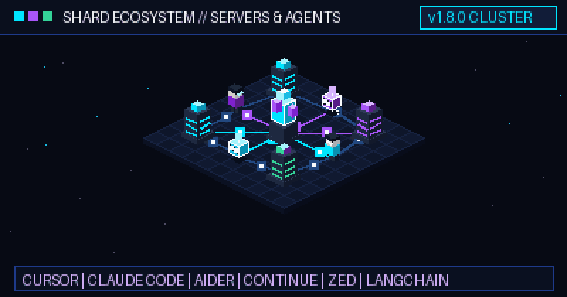
  <br>
  <sub><b>Топология экосистемы SHARD:</b> ИИ-редакторы кода, агентные фреймворки, центральный координатор и рабочие узлы LAN работают как единая вычислительная ткань.</sub>
</p>

### Схема архитектуры

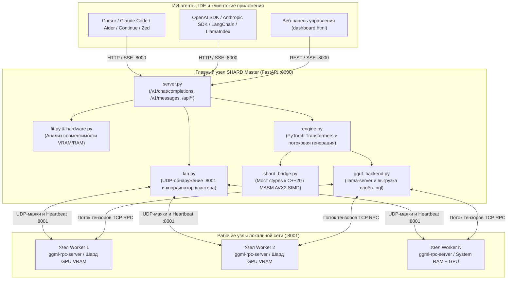

---

## Веб-панель и демонстрация

### Интерактивная панель управления (`dashboard.html`)
Откройте `http://localhost:8000` в браузере для доступа к панели управления SHARD:

<p align="center">
  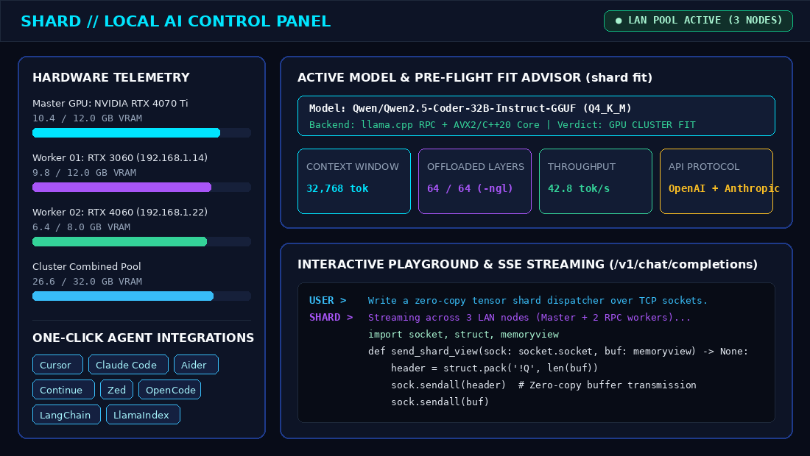
  <br>
  <sub><b>Панель управления SHARD:</b> Мониторинг VRAM/RAM по узлам в реальном времени, советник совместимости моделей, готовые конфигурации для IDE и интерактивный чат.</sub>
</p>

### Советник совместимости (`shard fit`) и статус кластера (`shard lan status`)

<p align="center">
  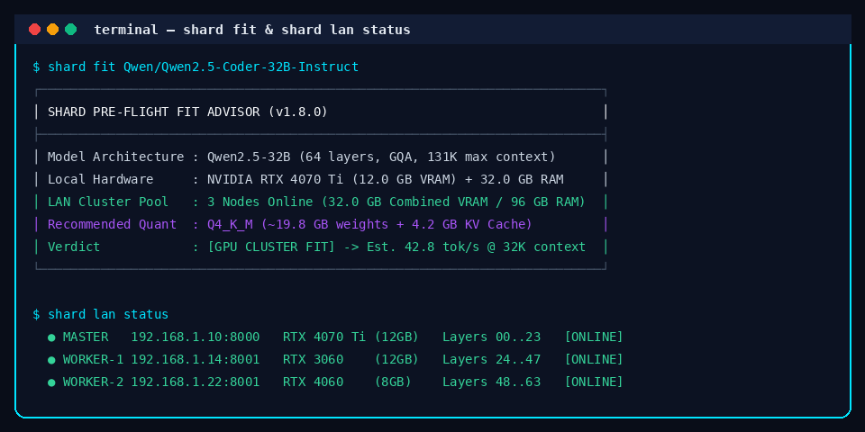
  <br>
  <sub><b>Предварительная проверка в CLI:</b> Оценка оптимального квантования, размера контекста и распределения слоёв по узлам LAN.</sub>
</p>

### Пример подключения через OpenAI Python SDK

```python
from openai import OpenAI

client = OpenAI(
    base_url="http://localhost:8000/v1",
    api_key="shard-local",  # Или сгенерируйте токен командой `shard key --gen`
)

stream = client.chat.completions.create(
    model="Qwen/Qwen2.5-Coder-7B-Instruct",
    messages=[{"role": "user", "content": "Объясни принцип тензорного параллелизма в локальной сети."}],
    stream=True,
)

for chunk in stream:
    if chunk.choices[0].delta.content:
        print(chunk.choices[0].delta.content, end="", flush=True)
```

---

## Статус проекта и сообщество

### Технологический стек
- **Сервер и API:** Python 3.8+ / 3.10+, [FastAPI](https://fastapi.tiangolo.com/), [Uvicorn](https://www.uvicorn.org/), [Pydantic v2](https://docs.pydantic.dev/)
- **Машинное обучение и квантование:** [PyTorch](https://pytorch.org/), Hugging Face [`transformers`](https://huggingface.co/docs/transformers), [`accelerate`](https://huggingface.co/docs/accelerate), [`safetensors`](https://huggingface.co/docs/safetensors), [`huggingface_hub`](https://huggingface.co/docs/huggingface_hub), [`llama.cpp` GGUF](https://github.com/ggml-org/llama.cpp)
- **Нативное ускорение:** C++20 (`native/shard_core.cpp`) + ассемблер x86-64 MASM AVX2 (`native/shard_asm.asm`)
- **Сеть и телеметрия:** `psutil`, широковещательное обнаружение UDP (`:8001`), потоковая передача HTTP/SSE (`:8000`)

### Документация и участие в разработке
- **Архитектура LAN-шардинга:** [`docs/LAN_SHARDING_DESIGN.md`](docs/LAN_SHARDING_DESIGN.md)
- **Руководство для контрибьюторов:** [`CONTRIBUTING.md`](CONTRIBUTING.md)
- **Кодекс поведения:** [`CODE_OF_CONDUCT.md`](CODE_OF_CONDUCT.md)
- **История изменений:** [`CHANGELOG.md`](CHANGELOG.md) (текущий релиз: `v1.8.0`)
- **Сообщения об ошибках и предложения:** [GitHub Issues](https://github.com/avelone123123/shard/issues)
- **Обсуждения и вопросы:** [GitHub Discussions](https://github.com/avelone123123/shard/discussions)
- **Безопасность:** О найденных уязвимостях сообщайте через [GitHub Security Advisories](https://github.com/avelone123123/shard/security).
- **Лицензия:** Проект распространяется под лицензией [MIT License](LICENSE).

---

<p align="center">
  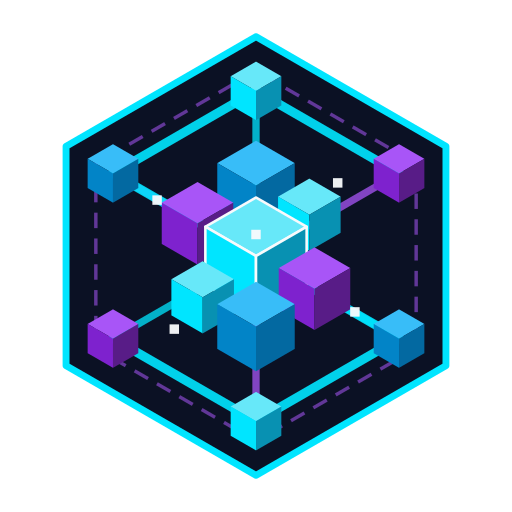<br>
  <strong>SHARD — Одна сеть. Множество серверов. Общая ИИ-инфраструктура.</strong><br>
  <sub>Создано для сообщества открытого локального ИИ &middot; <a href="README.md">English</a> &middot; <a href="README.ru.md">Русский</a> &middot; <a href="README.kz.md">Қазақша</a></sub>
</p>
